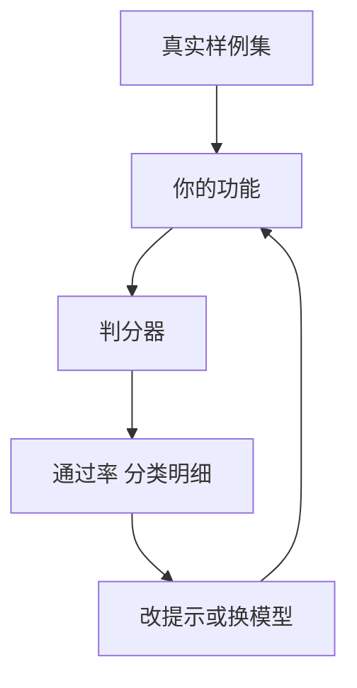

## Q
给自己的 LLM 功能写评测（eval），到底要写什么？一条样例长什么样，怎么判对错？

## A
**评测 = 几十到几百条真实样例 + 一个判分器 + 一条能一键重跑的命令；每次改提示或换模型都跑一遍。**



一条样例就是输入加期望：
```json
{
  "input": "我 3 天前买的耳机还没发货",
  "expect": {"label": "物流"},
  "tags": ["中文", "口语"]
}
```

`tags` 用来分组看通过率，免得总分把局部问题平均掉。

判分器三种：
- **代码判分：** 标签相等、JSON 能解析、测试能跑过；便宜、稳定，能用就用它。
- **模型当评委：** 按评分标准给开放回答打分，灵活但要和人工校准。
- **人：** 抽样检查，用来校准前两种。

**样例从哪来：** 线上真实输入，尤其是出过错的；不要靠自己想象。

**新进展（2026 年 10 月 – 11 月）。** 谷歌的 Gemini 4 Argon、Carbon 和 Anthropic 的 Fable 5.2 在不到一个月里相继发布，每次都可能要换模型。有一条命令能重跑的评测，才让"换不换"变成跑一次的事。

<details class="pt"><summary>想一想：如果你的评测每次要跑三小时、花 200 美元，会怎样影响你换模型的节奏？</summary>你会变得不敢常跑。可以分层：几十条的小集每次改动都跑，几百条的大集只在发布前或换模型时跑。</details>
