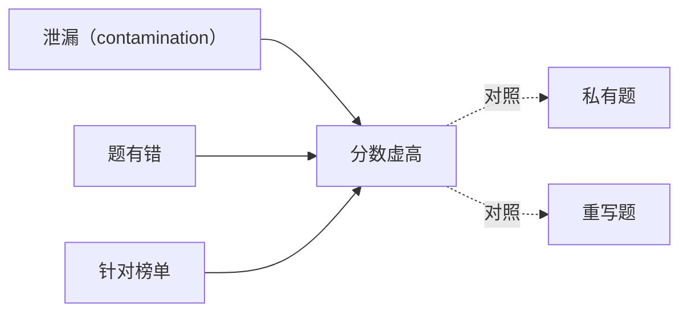

## Q
一个模型在公开基准上分很高，放到你们自己的仓库里却不行。基准的分数为什么会"虚高"？

## A
**三种虚高：题或答案泄漏进训练数据、题本身有错、针对榜单专门优化；私有题和重写题是对照办法。**

| 虚高来源 | 例子 |
|---|---|
| 泄漏（contamination） | Scale 人工新写 1,250 道同风格新题 GSM1k：部分开放模型比在原题 GSM8K 上低近 10 分，前沿闭源模型几乎没掉 |
| 题有错 | 判分用的测试太严，把正确解法判错 |
| 针对榜单 | 发布前同时试多个版本，只公布最好的那个 |

- **私有集更低：** SWE-bench Pro 的私有集用没公开过的公司代码。Scale 最初的分析里，Claude Opus 4.1 从公开集 22.7% 降到 17.8%，GPT-5 从 23.3% 降到 14.9%。
- **榜单优化：** 2025 年 4 月 Meta 发布 Llama 4 时，在 Arena 上跑的是一个专门调得更讨人喜欢的实验版（Elo 1417），公开发布的普通版只排第 32。

**新进展（2026 年 2 月）。** OpenAI 宣布不再汇报 SWE-bench Verified：审查的题里至少 59.4% 的测试会拒绝正确答案，所有受测的前沿模型都能复现人写的标准补丁，说明题已进了训练数据。OpenAI 建议改用 SWE-bench Pro。

想一想：模型能背出标准补丁，为什么就说明这个基准不能用了？
基准要测的是遇到没见过的问题能不能解。如果模型是背下来的，分数反映的是记忆，不是修 bug 的能力，换成真实新问题就会掉分。

