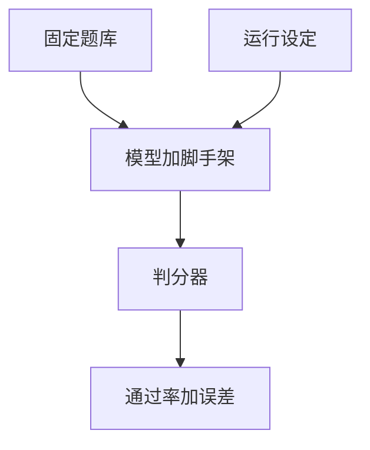

## Q
基准（benchmark）上的一个分数是怎么得出来的？为什么同一个模型在同一个基准上会有两个不同的分？

## A
**基准 = 一组固定的题 + 一条判分规则 + 一套运行设定；三样全相同，两个分数才能比。**

以 SWE-bench Pro（给模型一个真实代码仓库和一条 issue，让它改代码）为例：
- **题：** 一个仓库加一条 issue。
- **判分：** 改完后，藏起来的测试全部通过才算对。
- **设定：** 脚手架（scaffold，包在模型外面的工具和循环）、最多几轮、有没有成本上限。设定一变，同一个模型的分就变。
- **误差：** 题数有限，分数带置信区间。Scale 的标准化榜上榜首是 61.5%，区间约 ±3.1，所以两个相差 2 分的模型分不出高低。

**所以：** 厂商说"某基准 80%"时，先问脚手架、轮数、是否允许多次尝试取最好；设定宽松，同一个模型能高出十几分。
