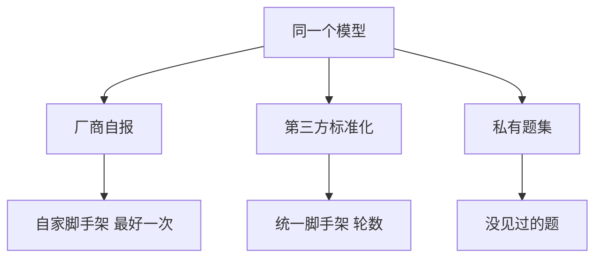

## Q
同一个模型在同一个榜上，为什么会同时出现好几个分数？厂商自报、第三方跑、私有集各是什么关系？

## A
**分数 = 模型 × 运行设定：自报分用厂商调好的设定，标准化榜用统一设定，私有集再去掉泄漏，三者依次变低。**

- **脚手架：** Scale 的标准化榜要求同一套代理、同样的轮数和成本上限，不同厂商自带的工具链不在其中。
- **思考强度：** 强度越高，分越高、越贵。
- **私有集：** 同样的模型，私有题上通常更低。

**新进展（2026 年 10 月）。** Artificial Analysis 公布：Claude Opus 5.5 在低强度下指数 35，最高强度下 58；每个指数任务的成本分别是 0.98 美元和 10.04 美元。同一个模型有两个分，价格差十倍。

想一想：比较两个模型的榜单分，除了分数本身还要对齐什么？
要对齐思考强度和脚手架，并且看每个任务的成本。否则可能是在拿一个开到最高强度的模型比另一个低强度的，差距来自多花的推理 token。

