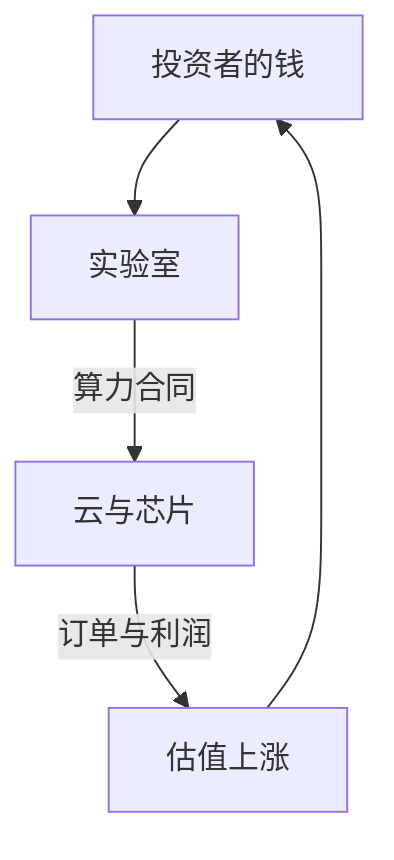

## Q
"AI 泡沫"论的核心算术是什么？怎么判断它破不破？

## A
**泡沫论的算术：投入先行、收入在后；多头的回答是收入翻倍增长，而且买家按能力而不是价格选模型。**

- **缺口：** 2026 年四家巨头资本开支约 7300 亿美元，企业 AI 部署花费约 1770 亿美元年化（不同口径，还有消费者订阅和广告，但差距大）。
- **增速：** 企业 AI 花费一年约 5.4 倍；Anthropic 上半年营收约 14 倍。
- **集中度：** OpenAI 和 Anthropic 两家占三大云收入的 25% 以上，它们放缓，云和芯片同时受冲击。
- **资金循环：** Anthropic 的招股书把"谷歌和亚马逊既是股东又是算力供应商"列为利益冲突风险。
- **先行指标：** 两家实验室的收入、云的在手订单、资本开支能否转为云收入。

**新进展（2026 年 10 月 – 11 月）。** Anthropic 在 10 月 26 日提交招股书，11 月 10 日起路演，拟在纳斯达克上市，代码 ANT，定价区间约每股 70–78 美元。这是"收入能否撑起估值"的一次公开检验。

想一想：上市为什么会让泡沫之争更容易检验？
私下估值变成了每天的标价，招股书又披露营业利润率、算力承诺和客户集中度，第三方能直接对比"收入"和"承诺"，不再靠传言。

