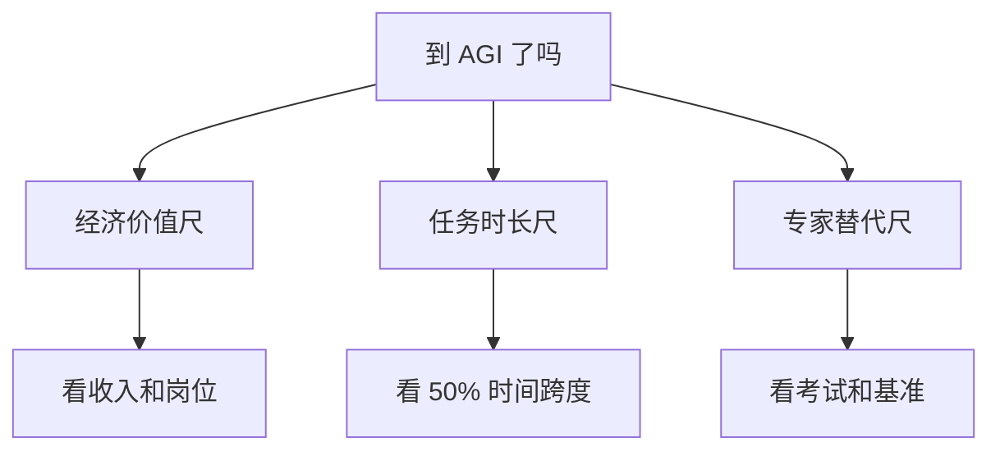

## Q
通用人工智能（AGI）到底指什么？为什么没人能说"到了没有"？

## A
**AGI 没有公认定义，各方各用一把尺子：能做多数有经济价值的工作、能独立完成多长的任务、能否替代专家；尺子不同，结论完全不同。**

- **经济价值：** OpenAI 的章程把 AGI 定义为在多数有经济价值的工作上超过人类的高度自主系统。现状：企业 AI 应用约 773 亿美元年化，编程占 340 亿，离"多数工作"还很远。
- **任务时长：** METR 量的是模型以 50% 成功率能完成的任务，按人类所需时间计；最初研究估计约每 7 个月翻一番。它的题目只覆盖软件、机器学习和网络安全，不能推到所有职业，也没有报告 99% 成功率。
- **专家替代：** 看考试和基准分数，但基准会饱和，也可能被针对性优化。

**新进展（2026 年 9 月）。** METR 说明，超过 16 小时的任务用现有题库已经测不准，页面也不再积极更新。曲线正在顶到测量工具的天花板。

想一想：时间跨度曲线测不准了，乐观派和怀疑派会各怎么解读？
乐观派说曲线只是被题库的上限截断，能力仍在涨；怀疑派说长任务缺乏可靠证据，软件题的结果不能外推到一般工作。两种解读都能自洽，要靠更长、更多样的任务来区分。

