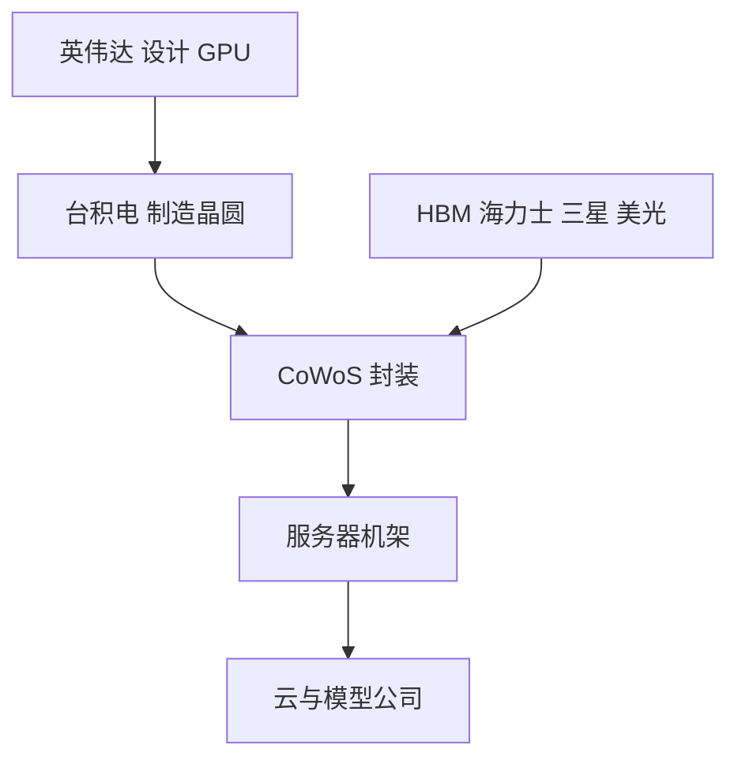

## Q
一块 AI 加速卡是怎么造出来的？为什么高带宽内存（HBM）和先进封装成了瓶颈？

## A
**一块加速卡 = 计算芯片 + 贴在它旁边的多层堆叠内存（HBM，高带宽内存）+ 把两者封在一起的先进封装（台积电的 CoWoS）：英伟达设计，台积电制造和封装，内存由三家做。**

- **为什么要 HBM：** 生成每个 token 都要把全部激活的权重和 KV 缓存从显存读一遍，速度受内存带宽限制，不是算力。HBM 把内存堆在芯片旁，带宽比普通显存高得多。
- **份额：** SK 海力士在 HBM 收入中约占 56%（2026 年第一季度）。
- **英伟达的体量（截至 2026 年 11 月）：** 2026 年 5 月至 7 月一个季度收入约 962 亿美元，其中数据中心约 890 亿，毛利率 75%。

**新进展（2026 年 8 月）。** 英伟达宣布下一代 Vera Rubin 机架已进入量产，CoreWeave、谷歌云、微软 Azure、甲骨文云等已在运行。

想一想：上一代还在赚钱时，云厂商和模型公司为什么抢着订下一代？
每 token 的成本决定谁能在保住毛利的同时降价。新一代宣称能把每 token 成本降到约十分之一，但这是厂商数字，所以买家要抢先拿到货并自己测。

