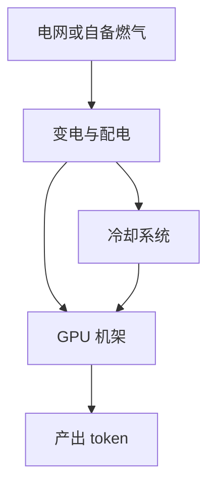

## Q
为什么现在用吉瓦（GW）来衡量 AI 数据中心？一个吉瓦的集群是什么规模？

## A
**吉瓦是电力功率单位，一吉瓦约等于一座中型电厂的输出；AI 集群按用电功率衡量，因为电力决定了能放多少芯片。**

- **规模感：** 一个吉瓦大约能供几十万到一百万块加速卡及其冷却。Anthropic 与谷歌在 2025 年 10 月宣布，最多使用 100 万块 TPU，2026 年新增超过 1 吉瓦。
- **OpenAI 和甲骨文的德州 Abilene 园区：** 规划 1.2 吉瓦，目标 2026 年第四季度到位；Stargate 的七个站点合计规划超过 9 吉瓦（到 2029 年）。
- **所以用功率说话：** 机器台数随芯片代际变化，而一吉瓦是一个稳定的量级。

**新进展（2026 年 4 月）。** 独立估算把 Abilene 当时的运行容量下调：甲骨文的一篇文章显示只有约 200 兆瓦在运行，低于此前估计的约 600 兆瓦；1.2 吉瓦仍预计在第四季度。

想一想：为什么同一个园区，"已交付""已通电""在运行"的数字差这么多？
建筑交付不等于通电、联网和装满 GPU；园区设计功率也不等于可用功率。读容量数字要先问清口径是哪一种。

