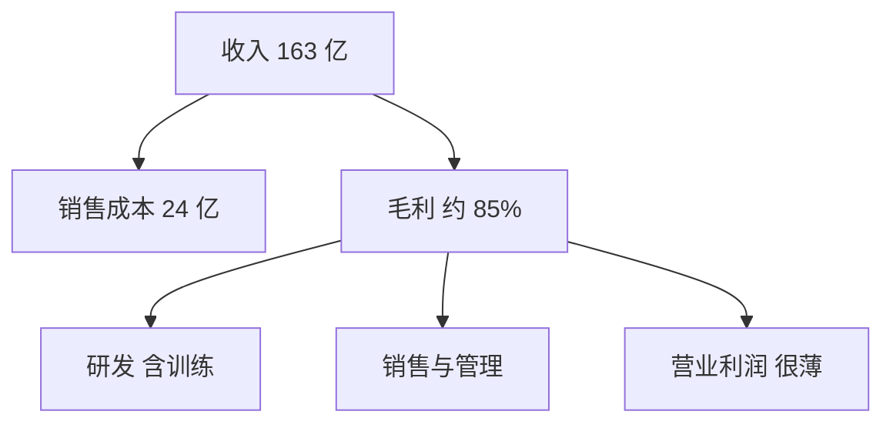

## Q
按 token 卖的模型公司毛利有多高？为什么毛利高，整体却几乎不赚钱？

## A
**服务用户本身赚钱（Anthropic 2026 年上半年按招股书推算毛利约 85%），但训练算力记在研发里，吃掉大部分，营业利润率只有个位数。**

- **算法：** 上半年收入约 163 亿美元，销售成本约 24 亿（毛利约 85%；上年同期成本约 10 亿对收入约 12 亿，毛利只有十几个百分点）。但全部算力和基础设施支出约 89 亿，其中只有约 24 亿记入销售成本。
- **营业利润：** 2026 年二季度营业利润约 9.7 亿美元，约占收入 8%，是招股书里首次出现的营业盈利。
- **用与建：** 企业在"使用 AI"上的花费（约 1770 亿美元）约是"训练模型"（约 1025 亿）的 1.7 倍，使用的钱已超过训练。

**新进展（2026 年 10 月）。** 招股书警示营业利润率会波动：算力要提前很久签约，现在的成本反映的是收入低得多时订的容量；大批容量集中上线时成本一次性压上来，收入跟不上就会挤压利润。

想一想：为什么毛利 85% 的公司，下一个季度营业利润率仍可能下降？
毛利只算服务用户的成本；训练和新容量的成本在研发和折旧里。新一批算力上线时这些成本会跳升，若收入增速没跟上，营业利润率就会收缩。

