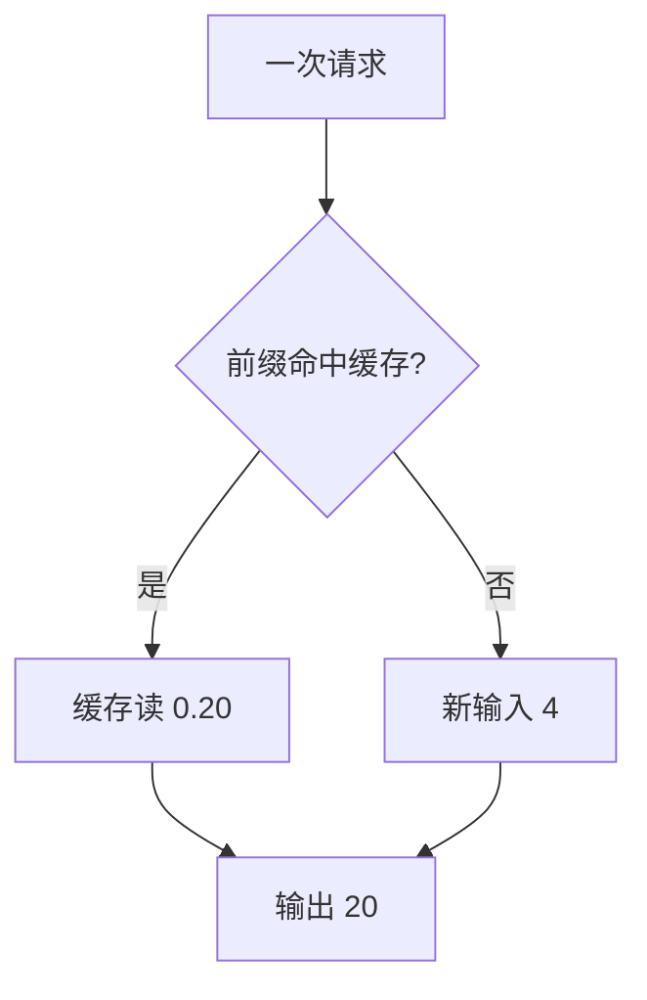

## Q
一次模型调用怎么算钱？价格表里的"输入、输出、缓存读"各是什么？

## A
**价格按三种 token 分别计：新输入、输出、缓存读；缓存读只有新输入价的 5%，所以智能体能便宜地反复读长上下文。**

Claude Opus 5.5 每百万 token 的价格（美元，截至 2026 年 11 月）：新输入 4，缓存读 0.20，输出 20。

- **缓存读为什么便宜：** 缓存下来的前缀就是这段文字已经算好的 KV 状态，命中后不用重算预填充，只需读出。
- **输出为什么贵：** 输出要一次生成一个 token，每步都占着整个模型。
- **例子：** 一个 10 万 token 的代码库前缀，第一次花 0.40 美元，之后每次命中只要 0.02 美元。

**新进展（2026 年 9 月）。** 一份企业调查估计，智能体的 token 里缓存读可以占到 95% 以上；闭源模型 token 的混合均价一年里降了 24%，到约 0.70 美元每百万。智能体占比越高，平均 token 价格越低。

想一想：平均 token 价格在下降，为什么企业的总花费反而暴涨？
缓存读很便宜，拉低了均价；但智能体并行、不停工，token 总量增长得比均价下降更快。调查估计企业 AI 部署花费一年里涨到约 5.4 倍。

