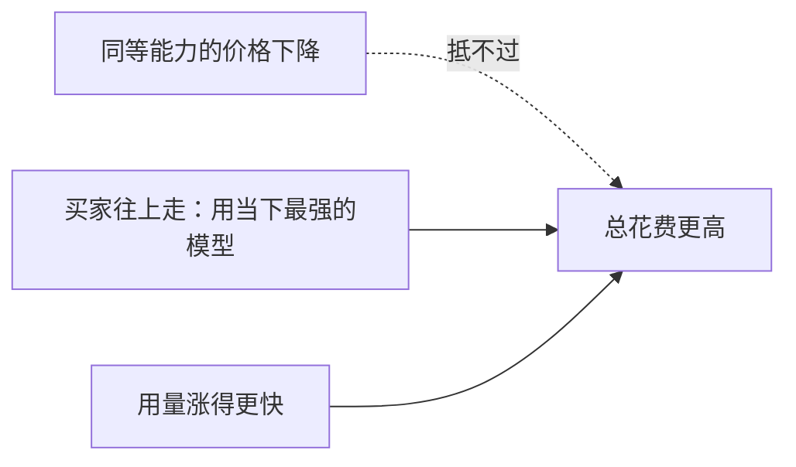

## Q
同样能力的价格每年降多少？为什么总花费反而暴涨？

## A
**同等能力的价格每年降一到两个数量级，但人们总想用当下最强的模型，用量涨得更快，总花费更高。**

- **同能力降价：** GPT-4 水平的 MMLU 成绩，2023 年 3 月每百万 token 要 37.5 美元，2025 年 2 月降到 0.18 美元，约 200 倍；到达同一水平的价格每年降幅从 9 倍到 900 倍不等，中位数约 40 倍。
- **旗舰价没怎么降：** Claude Opus 4.1 是 15/75 美元，到 Opus 5.5 是 4/20，而上面又多了一档 8/40 的 Fable 5.2。
- **买家往上走：** 一年前最常用的是 Sonnet 4.5（3/15 美元），现在是 Opus 5.5（4/20 美元）。
- **用量：** 谷歌自家接口每分钟处理约 320 亿 token（2026 年第三季度），是一年前的 4 倍多，折合每天约 46 万亿。
- **花费：** 企业 AI 部署花费从约 330 亿涨到约 1770 亿美元（2025 年到 2026 年 9 月的调查估计）。

**新进展（2026 年 9 月）。** Opus 5.5 单价比 Opus 5 低 20%（4/20 对 5/25），Anthropic 称典型任务的运行成本降低约 40%。

想一想：单价降 20%，典型任务成本却降 40%，这说明了什么？
任务成本 = 单价 × token 数。模型用更少的 token 完成同一任务，贡献了剩下的降幅，所以比较成本要看每个任务的总花费，而不是每百万 token 的单价。

