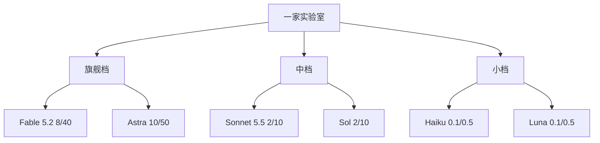

## Q
各家的模型怎么分档、什么价？综合榜上谁排第一？

## A
**每家都按大、中、小三到四档卖，旗舰比小档贵约一百倍；综合榜上 Anthropic 暂时领先，但名次几个月就换一次。**

价格是每百万 token 的输入/输出美元数（截至 2026 年 11 月）。旗舰约 8–10 美元输入，小档 0.10 美元，差约 80–100 倍。

**榜上位置：** 独立评测机构 Artificial Analysis 的综合指数（v5）前三名是 Claude Fable 5.2（65）、Gemini 4 Carbon（60）、Claude Opus 5.5（59）。同一个模型在榜上有多个条目：Fable 5.2 在最高思考强度下 65，低一档强度下 62。

**新进展（2026 年 10 月 – 11 月）。** 谷歌的 Gemini 4 Argon（10 月中）和 Carbon（10 月 28 日），再加 Anthropic 的 Fable 5.2（11 月 9 日），不到一个月三次发布，榜首随之变化。

想一想：为什么同一个模型在榜上有好几个分数？比较两个模型时该怎么对齐？
思考强度越高，模型用越多的推理 token，得分更高，也更贵更慢。要比较就得对齐强度，或者对齐每个任务的总成本。

