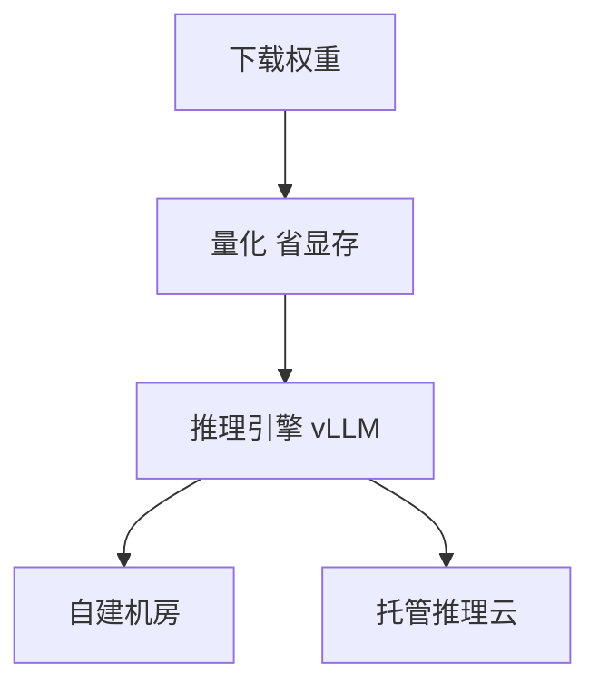

## Q
公司想把 Kimi 或 DeepSeek 的权重下载下来自己部署，要过哪几关？

## A
**能下载不等于能用：要过硬件、许可证和合规三关，很多公司最后选了托管推理服务而不是自建。**

- **硬件：** Kimi K3.1 Pro 总参数 2.8 万亿，量化（用更少的位数存参数）到 4 位也要约 1.4 TB。混合专家模型每个 token 只激活 1040 亿参数，但所有专家都得放在显存里，所以要多台 8 卡服务器。
- **许可证：** DeepSeek 用 MIT；Kimi、通义千问、GLM、MiniMax 各有自己的许可证文件，商用条款要读。
- **合规：** 开放权重花费的约 89% 属于中国团队，有些企业对数据和供应链有审查要求。
- **现实：** 对开放模型做后训练的构建者只占约 10%，其中 91% 找外部伙伴。

想一想：为什么每个 token 只激活 1040 亿参数，显存仍要放下 2.8 万亿？
每个 token 走哪些专家由路由器临时决定，下一个 token 可能走另一批专家，所以所有专家都必须随时可取。省的是计算量，不是存储量。

