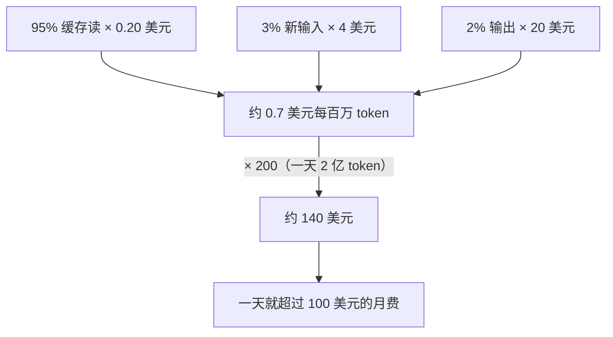

## Q
一个每月 100 美元的 Max 订阅用户让编程智能体连续跑一天，公司会亏吗？订阅制在智能体时代怎么变形？

## A
**可能亏：订阅是固定价，智能体吃的是变动成本；所以订阅按"用量倍数"分档并设窗口限额，企业版直接按用量计。**

**估算（假设一天跑 2 亿 token）：** 智能体 95% 以上的 token 是缓存读（命中已算好的前缀），Opus 5.5 的缓存读 0.20 美元每百万，新输入 4 美元，输出 20 美元。按 95% 缓存读、3% 新输入、2% 输出混合，约 0.7 美元每百万 token。

- 2 亿 token ≈ 200 × 0.7 ≈ 140 美元（按标价），一天就超过 100 美元的月费。
- 实际成本低于标价，但重度用户的成本远高于普通用户是事实。

**产品上的变形（截至 2026 年 11 月）：**
- Max 是 Pro 的 5 倍用量，Ultra 是 10 倍周用量；订阅有 5 小时窗口限额。
- 企业版每席位 20 美元，用量另按接口价计费。

**新进展（2026 年 9 月）。** 一份企业调查估计，2026 年企业 AI 的实际花费平均是上一年的 4.7 倍，而计划只有 1.9 倍。调查把原因归于智能体：它们按工作量而不是按人头扩张。

想一想：对采购方的财务负责人，这意味着预算该怎么设？
按席位预算已经预测不了花费，要按任务或用量设上限、做监控和分摊，并给重度用户设单独的额度。

