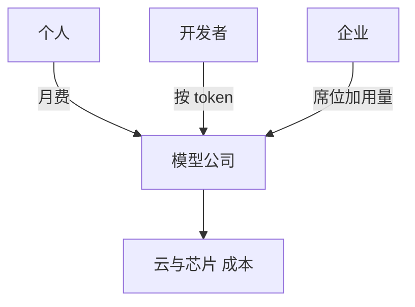

## Q
AI 公司靠什么收钱？订阅、接口和企业版各怎么计费？

## A
**三条收入线：个人订阅按月收，接口按 token 收，企业版按席位加用量收。**

截至 2026 年 11 月：

| 线 | 例子 | 价格 |
|---|---|---|
| 订阅 | Claude Pro / Max / Ultra | 每月 20 / 100 / 200 美元 |
| 订阅 | ChatGPT Go / Plus | 每月 8（带广告）/ 20 美元 |
| 接口 | Claude Opus 5.5 | 每百万 token 输入 4、输出 20 美元 |
| 企业 | Claude Enterprise | 每席位每月 20 美元，用量另按接口价 |

**新进展（2026 年 2 月 – 8 月）。** ChatGPT 2026 年 2 月起在美国的免费档和 Go 档显示广告，到 8 月底广告业务的年化收入约 10 亿美元，成了第四条收入线。

想一想：为什么广告只出现在最便宜的两档，20 美元的 Plus 没有？
推理有成本，免费用户的成本要由广告覆盖，付费 20 美元的用户由订阅覆盖。按用户能带来的价值分层，各档各自收支平衡。

