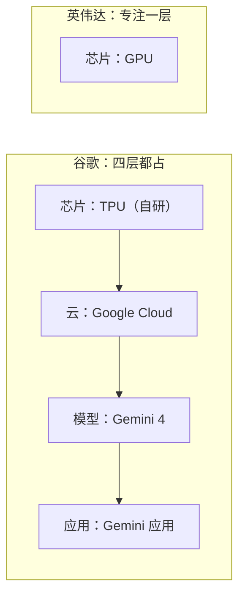

## Q
为什么大公司都想跨层？谷歌、SpaceX、Anthropic 和英伟达各占了哪几层？

## A
**跨层是为了把相邻一层的利润和瓶颈收进自己手里：握着稀缺的一层，就能给别人定价。**

截至 2026 年 11 月：

| 公司 | 芯片 | 云 | 模型 | 应用 |
|---|---|---|---|---|
| 谷歌 | TPU（自研） | Google Cloud | Gemini 4 | Gemini 应用，月活超 10 亿 |
| SpaceX（含 xAI） | 无 | 自建数据中心 | Grok | Cursor（2026 年 8 月收购） |
| Anthropic | 租用 TPU、Trainium、GPU | 经三大云出售 | Claude | Claude Code |
| 英伟达 | GPU | 无 | 无 | 无 |

- **专注一层：** 英伟达只做芯片，毛利约 75%，这是它的客户的成本。
- **跨层：** 谷歌用自研 TPU 训练和运行 Gemini，等于少付一份英伟达的利润。

**新进展（2026 年 4 月 – 8 月）。** SpaceX 4 月拿到以 600 亿美元买下 Cursor 的选择权，6 月行权，8 月完成全股票收购。Cursor 原本向多家模型公司买 token，如今和 Grok 同属一家：模型层向应用层延伸。

想一想：模型公司为什么愿意花 600 亿美元买一个原本给它送 token 订单的应用？
编程是企业 AI 应用里最大的一类，应用掌握用户入口和使用数据。买下后既能拿应用层的利润，又能把 token 需求导向自家模型。

