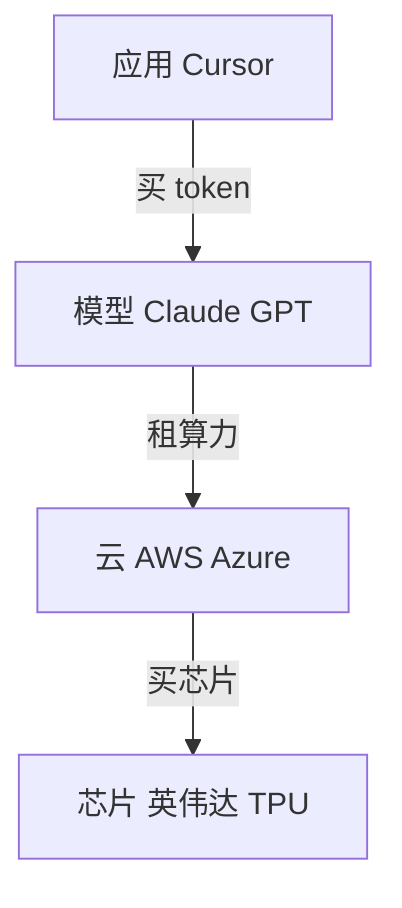

## Q
AI 产业分成哪四层？你在 Cursor 里点一次代码补全，请求要穿过哪几层？

## A
**四层从上到下是应用、模型、云、芯片：应用向模型公司买 token，模型公司向云租 GPU，云向芯片厂买芯片，钱沿这条链一层层往下付。**

- **例子：** 点一次补全，Cursor 把代码和问题发给模型公司的接口，按 token 计费；模型跑在云上的 GPU（图形处理器，擅长并行矩阵运算）里；GPU 由英伟达设计、台积电制造。
- **各层的体量（截至 2026 年 11 月）：**
  - 芯片：英伟达 2026 年 5 月至 7 月一个季度的数据中心收入约 890 亿美元。
  - 模型：Anthropic 2026 年上半年营收约 163 亿美元。
  - 应用：企业买的 AI 应用约 773 亿美元（按当前速度推算的全年值），其中编程约 340 亿。
