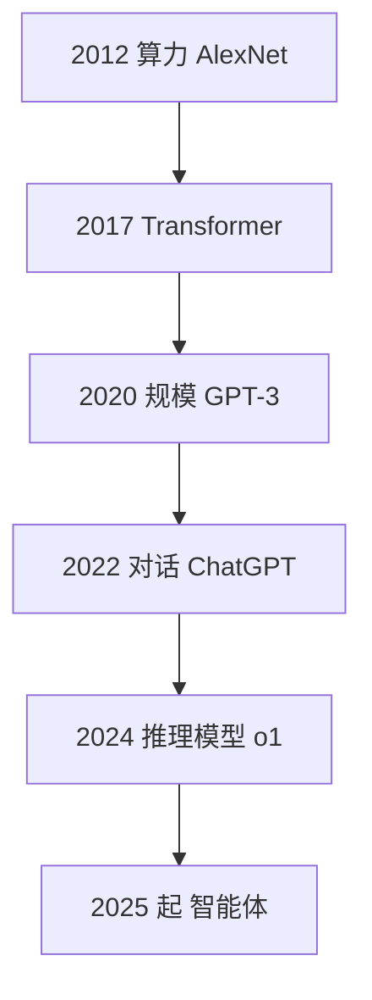

## Q
从 2012 年到现在，AI 的关键节点是哪几个？每个节点背后是谁？

## A
**七个节点串起主线：算力让深度学习成立 → Transformer → 规模化 → 对话产品 → 推理模型 → 智能体 → 上市与基建。**

| 年份 | 事件 | 人或机构 |
|---|---|---|
| 2012 | AlexNet 用两块 GPU 训练，图像识别错误率大幅下降 | Krizhevsky、Sutskever、Hinton |
| 2017 | 论文《Attention Is All You Need》提出 Transformer | 谷歌的八位作者（Vaswani 等） |
| 2020 | GPT-3（1750 亿参数）显示规模带来新能力 | OpenAI |
| 2022 年 11 月 | ChatGPT 发布，两个月用户过亿 | OpenAI，Altman |
| 2024 年 9 月 | o1：先想再答的推理模型 | OpenAI |
| 2025 年 1 月 | DeepSeek-R1：开放权重，强化学习学出推理 | DeepSeek，梁文锋 |
| 2025 年 11 月 | Claude Opus 4.5：多步任务可少量监督，智能体拐点 | Anthropic |

**新进展（2026 年 6 月 – 11 月）。** 2026 年 6 月 Fable 5 发布，随即遇到美国商务部的出口限制；9 月 OpenAI 发布 GPT-6 Astra；10 月底 Anthropic 提交招股书。AI 公司开始进入公开市场。

想一想：为什么是 2022 年的 ChatGPT 而不是 2020 年的 GPT-3 让公众开始用？
GPT-3 是给开发者的接口，只会续写；ChatGPT 加上指令微调和对齐训练，变成会听指令的对话产品，并且有一个任何人都能用的网页。

