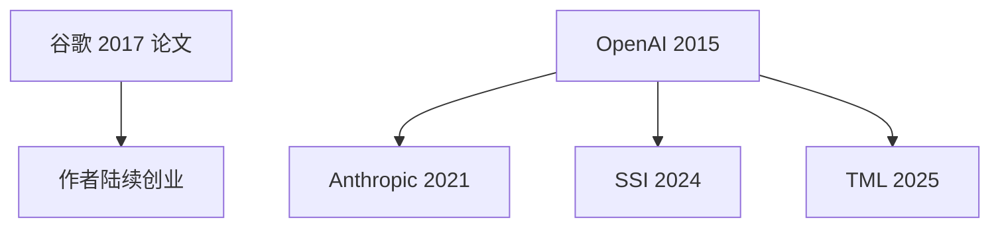

## Q
常被提到的人各是谁、做过什么？现在的主要玩家是怎么一脉相承的？

## A
**一条主线：谷歌和 OpenAI 的早期成员后来各自出去创办了现在的主要玩家。**

| 人 | 做过什么 |
|---|---|
| Hinton | 深度学习先驱，AlexNet 的导师，2024 年诺贝尔物理学奖 |
| Sutskever | AlexNet 作者，OpenAI 联合创始人，2024 年创办 SSI |
| Altman | OpenAI 首席执行官 |
| Dario 与 Daniela Amodei | 2021 年离开 OpenAI，创办 Anthropic |
| Murati | OpenAI 前技术负责人，2025 年创办 Thinking Machines（TML） |
| Hassabis | DeepMind 创始人，AlphaFold 获 2024 年诺贝尔化学奖 |
| 黄仁勋 | 英伟达创始人兼首席执行官 |
| Karpathy | 前 OpenAI 和特斯拉，2025 年 2 月提出"vibe coding"一词 |
| 梁文锋、杨植麟 | DeepSeek、Kimi 的创始人 |

**新进展（2026 年 2 月）。** SpaceX 在 2 月 2 日以全股票方式收购 xAI，把马斯克的 AI 公司并入 SpaceX。

想一想：xAI 自己建了大集群，却选择并入 SpaceX，说明了什么？
前沿训练和服务的资金需求太大，需要更大的资产负债表，并入后也能借 SpaceX 的上市给早期投资人流动性。

