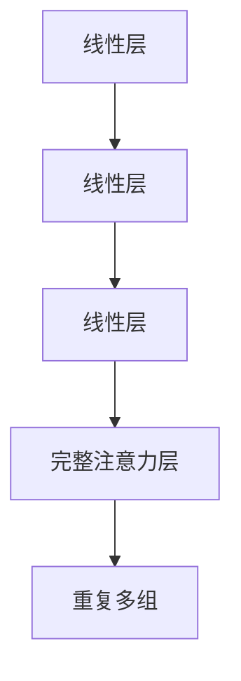

## Q
注意力在长文本上为什么越来越贵？状态空间模型（SSM，如 Mamba）和混合架构是怎么解决的？

## A
**注意力的计算量随长度平方增长，KV 缓存随长度线性增长；状态空间模型把历史压进固定大小的"状态"，每个新 token 成本恒定，代价是对早先内容的精确回忆变弱，所以实际用的是混合：少量注意力层加大量线性层。**

- **平方增长：** 每个新 token 要和前面所有 token 配对，长度扩大 100 倍（1 万到 100 万），总配对数扩大约 1 万倍。
- **状态空间模型：** 每个新 token 只更新一个固定大小的状态，不再回看全部历史，成本不随长度增长；但历史被压缩，逐字引用远处的内容更难。

| | 完整注意力 | 线性层或 SSM | 混合（3 比 1） |
|---|---|---|---|
| 每新 token 成本 | 随长度增长 | 固定 | 介于两者 |
| 缓存 | KV 随长度线性增长 | 固定大小的状态 | 只剩约四分之一的层有 KV |
| 弱点 | 长文本贵 | 精确回忆弱 | 工程更复杂 |

**新进展（2025 年 9 月 – 12 月）。** 2025 年 9 月，阿里的 Qwen3-Next 用三层线性注意力（Gated DeltaNet）配一层完整注意力，总参数 800 亿、每 token 激活约 30 亿，Apache 2.0；12 月，NVIDIA 的 Nemotron 3 Nano 用 Mamba-2、少量注意力层和混合专家，总参数 300 亿、激活约 30 亿，上下文 100 万 token，NVIDIA 称吞吐约为同尺寸 Transformer 混合专家的 3.3 倍。

想一想：为什么长任务的智能体特别需要这类混合架构？
智能体的上下文长，KV 缓存往往占去显存的大头，缓存小了每张卡能同时服务更多会话，每个会话的成本也更低。但它们常要逐字引用工具返回的内容，所以保留少量完整注意力层来兜底。

