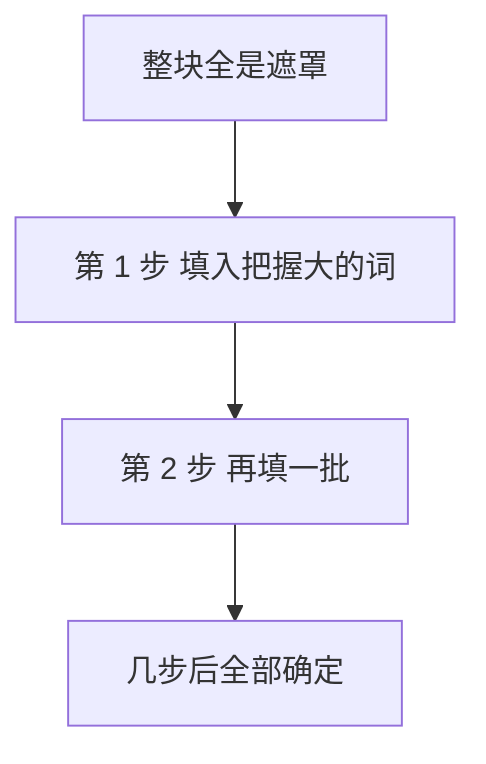

## Q
扩散语言模型（diffusion LLM）怎样"一次写出很多个 token"？它的代价是什么？

## A
**扩散语言模型从一整块被遮住或带噪的 token 出发，每一步并行修改很多位置，几步就收敛，出字速度高；代价是各位置同时决定，彼此一致性更难保证，推理生态也不如自回归成熟。**

- **自回归：** 输出 1,000 个 token 要做 1,000 次前向，每次读一遍权重，只追加一个 token。
- **扩散：** 输出 1,000 个 token 只要 T 次前向，假设 T = 20，就少 50 倍；每次处理整块，计算更密，更能吃满 GPU。
- **一致性风险：** 同一步里并行填入的词互相看不到对方的选择，容易出现重复或衔接不上；步数少速度快，步数多质量回升，是一个速度和质量的旋钮。
- **生态：** 现有的推理引擎、前缀缓存、工具调用都是围绕一次一个 token 设计的，需要另做适配。

**新进展（2026 年 2 月）。** Inception Labs 发布 Mercury 2，称是首个基于扩散的推理语言模型：厂商数字是在 NVIDIA Blackwell 上约 1,009 token 每秒，端到端 1.7 秒；价格每百万 token 输入 0.25 美元、输出 0.75 美元，上下文 128K。

想一想：为什么语音助手、实时补全这类低延迟场景最先受益？
用户等的是整段输出完成的时间，并行出字缩短了整段时间。推理模型先要写一大段思考，自回归下思考越长越慢，扩散可以并行完成这段。

