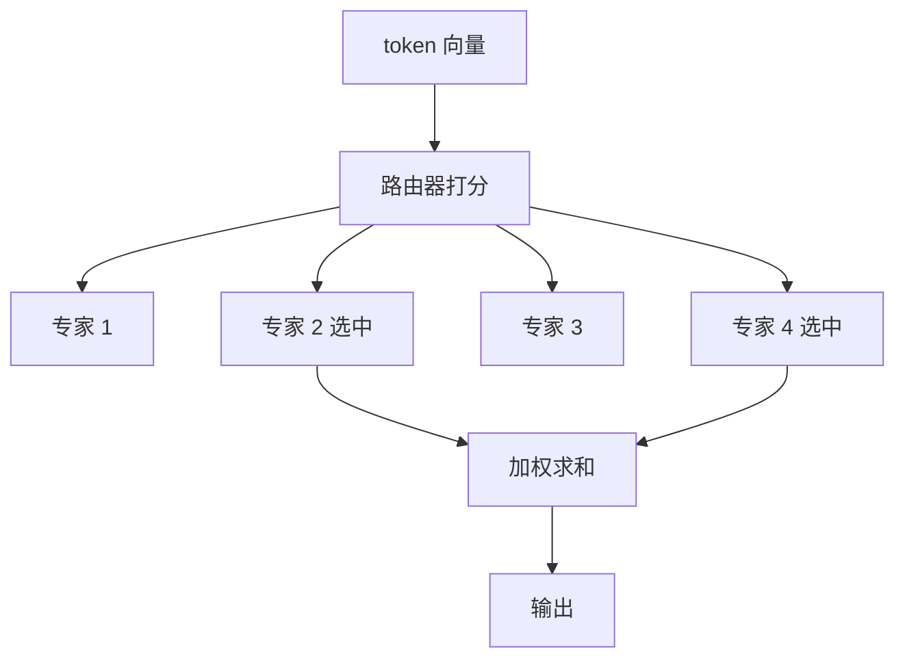

## Q
混合专家（MoE，mixture of experts）模型是怎么做到"参数很多、每个 token 算得很少"的？路由器怎么挑专家？

## A
**混合专家把每层的前馈网络换成很多个"专家"，路由器给每个 token 挑几个去算：总参数很大，但每个 token 只用其中一小部分，所以同样的计算量能装下更多知识。**

- **路由：** 路由器是一个小的线性层，给每个专家打分，取分最高的 k 个，把分数归一化当作权重，对这 k 个专家的输出加权求和。
- **负载均衡：** 如果总是选同几个专家，其余专家白白占着参数，被选中的那几张卡变成瓶颈；训练时要加约束，让每个专家的 token 数大致相当。
- **专家的分工：** 是训练中自己形成的，通常看不出"数学专家、法律专家"这样整齐的学科分工。
- **算力和内存：** 计算量跟着激活参数走，内存跟着总参数走。

截至 2026 年 11 月，两个开放权重旗舰的数字：

| 模型 | 总参数 | 每 token 激活 | 占比 |
|---|---|---|---|
| Kimi K3.1 Pro | 2.8 万亿 | 1,040 亿 | 约 3.7% |
| MiniMax M3 | 4,280 亿 | 230 亿 | 约 5.4% |
