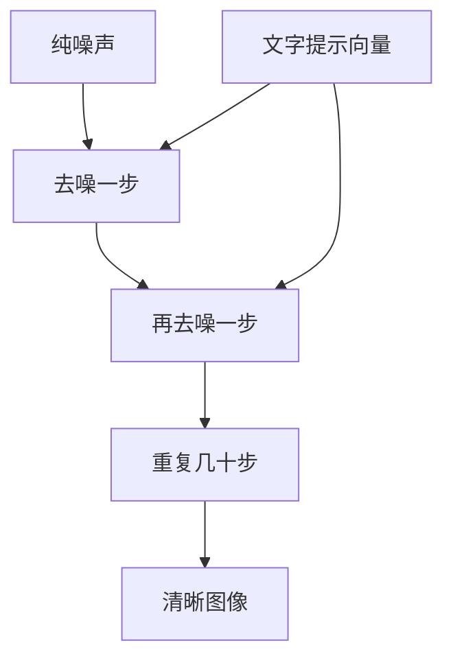

## Q
扩散模型（diffusion model）是怎样生成一张图片的？它和大模型一个字一个字地写有什么不同？

## A
**扩散模型从一张纯噪声图出发，反复预测并去掉一点噪声，经过几十步得到图像；每一步都修改整张图，而不是从左到右一个一个地写。**

- **训练：** 拿一张真实图，加上随机强度的噪声，让网络预测加了什么噪声，误差越小越好。这是一个很简单的回归问题，不需要人标注。
- **生成：** 从纯噪声开始，每步预测噪声并减掉一部分，重复固定的 N 步。文字提示被编码成向量，在每一步注入。
- **潜空间：** 直接在像素上去噪太贵，先把 512×512×3（78.6 万个数）压成 64×64×4（1.6 万个数），小 48 倍，在压缩后的空间去噪，最后再解码成图。

| | 文字（自回归） | 图像（扩散） |
|---|---|---|
| 一步做什么 | 追加一个 token | 把整张图都修正一点 |
| 总步数 | 输出多长就多少步 | 固定的几十步 |
| 主干网络 | Transformer | 早期用 U-Net，现多用 Transformer |
