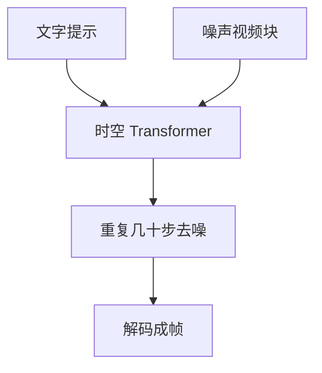

## Q
视频生成在扩散的基础上多了什么？为什么它的算力成本比图像高得多，也更难保持前后一致？

## A
**视频把时间也当作一个维度一起去噪：token 数是图像的几百倍，注意力计算随 token 数的平方增长，所以又贵，又难让每一帧里的人和物保持不变。**

**算一笔账：** 10 秒 × 24 帧 = 240 帧。设每帧压成 1,000 个潜空间小块，整段是 24 万个 token；一张图是 1,000 个。

| | 图像 | 视频（10 秒） |
|---|---|---|
| token 数 | 1,000 | 24 万 |
| 注意力的配对数（约 n²） | 10⁶ | 5.76×10¹⁰，是图像的 57,600 倍 |
| 时间方向压缩 4 倍后 | | 仍是图像的 3,600 倍 |

- **一致性：** 人物换脸、物体变形、物理不对（穿模），片段越长越明显。
- **做法：** 把视频切成时空小块，用 Transformer 对整块一起去噪；有的模型同时生成同步的声音。

**新进展（2026 年 3 月）。** OpenAI 宣布停掉 Sora 应用和接口，理由是把精力放到编程、数据分析这类企业用户上，算力需求在增长；Sora 团队转做面向机器人的世界模拟研究。

想一想：从每次输出的算力看，为什么视频生成比文本更难做成"赚钱的业务"？
一次视频要对几十万 token 做几十步去噪，用户常常生成多条再挑一条；一次文本回答只要几百个输出 token。算力紧张时，每一份算力应该给回报更高的业务，编程智能体的需求正在增长。

