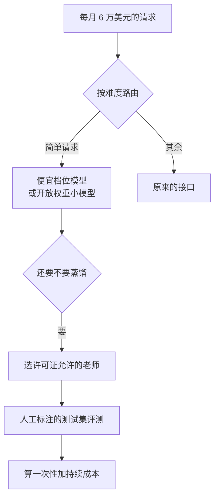

## Q
**挑战。** 一家公司每月在闭源接口上花 6 万美元，其中大部分是自家工单分类和摘要。CTO 说："我们拿 Claude 的输出蒸馏一个自己的 7B 模型，以后就不用付钱了。"你怎么评估这个计划？

## A
**评分点（答出 3 条算过）：**

1. 合规：接口条款通常不允许用输出训练竞争模型，大规模套取还会被封号；应选许可证明确允许的老师（如 MIT 或 Apache 2.0 的开放权重模型）或有权使用的数据。
2. 上限：学生不会超过老师，只有任务窄（自家的工单类别）时才可能追平，通用能力不会"变成 Claude"。
3. 数据与评测：训练数据要覆盖线上分布，测试集要人工标注，不能用老师的标签当真值；上线后监控偏移。
4. 算账：生成数据、训练、评测、部署运维是一次性加持续成本，要和 6 万美元的账单里"简单请求"的比例相比较，不能假设降到零。
5. 更小的第一步：先做路由（按难度把请求分给不同模型），把简单请求交给便宜档位模型或开放权重小模型，再决定要不要蒸馏。

参考答案
首先要查合规，闭源接口的条款通常禁止用输出训练竞争模型，应换成许可允许的老师。学生的上限是老师，只有窄任务才可能追平，要用人工标注的测试集评测，并覆盖线上分布，不能把老师的标签当真值。账要算清：数据生成、训练、运维是一次性加持续成本，不会让账单变零。可以先把简单请求路由到便宜模型，看剩下多少再决定。

