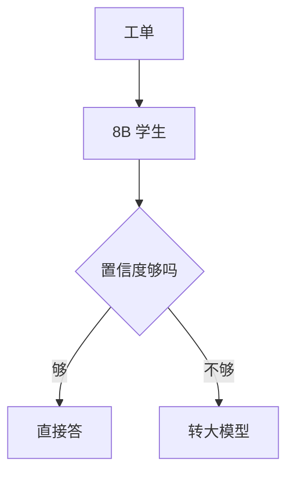

## Q
用大模型生成的 5 万条标注蒸馏进一个 8B 模型做工单分类，离线测试 94%，上线只有 80%。可能哪里出了问题？

## A
**学生只学到老师的样子：老师的错一起被学走，训练没覆盖的情况它没见过，参数少又记不住冷门知识；还要留意许可条款。**

- **分布偏移：** 5 万条是历史数据，线上有新类型、错别字、多种语言。
- **离线 94% 的含义：** 如果测试集的标签也是老师标的，94% 只说明"和老师一致"，不是"正确"。
- **容量：** 小模型对长尾实体和冷门知识更差，更容易编造。
- **条款：** 很多闭源接口的使用条款不允许用输出训练竞争模型；批量套取会被视为违规。

**修法：**
- 用人工标注的测试集评测，不用老师的标签当真值。
- 抽取线上流量重新采样训练，把难例加进去。
- 学生不确定时转大模型（级联），并统计转发比例。
- 级联的阈值用人工标注的验证集定：过松，错答变多；过紧，大部分请求都转大模型，小模型省不下钱。
