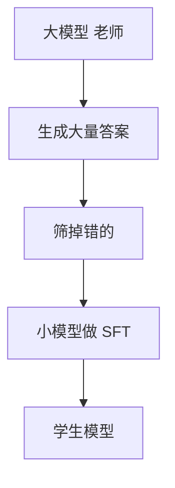

## Q
蒸馏（distillation）是什么？大模型怎样把能力"教"给小模型？

## A
**蒸馏是让小模型（学生）学大模型（老师）的输出：学老师写出的答案，或学老师每一步的概率分布；学生的上限是老师。**

| 做法 | 学生学什么 | 例子 |
|---|---|---|
| 学答案 | 老师写的完整回答，当作 SFT 数据 | DeepSeek 用 R1 的约 80 万条解答，训练 1.5B 到 32B 的 Qwen 和 8B、70B 的 Llama |
| 学分布 | 老师对下一个 token 的概率分布 | 老师给"猫 0.70、小猫 0.20、狗 0.05"，学生学这个形状 |

- **学分布更富信息：** 一个位置上不只告诉学生正确答案，还告诉它哪些错的"很接近"；代价是要拿到老师的概率，闭源接口通常不给。
- **和 SFT 的关系：** 蒸馏就是 SFT，只是示范由机器而不是人来写。
- **好处：** 小模型便宜、快，能在手机和笔记本上跑。

**新进展（2026 年 2 月）。** Anthropic 指控 DeepSeek、Moonshot、MiniMax 通过约 2.4 万个欺诈账号，与 Claude 产生了超过 1,600 万次对话，目标是智能体推理、工具调用和编程。Anthropic 同时说明蒸馏本身是合法的常用技术，问题在于用它快速、低成本地拿走别家的能力。

想一想：为什么他们专门去套取推理过程、工具调用这类输出？
长推理轨迹和多步工具调用轨迹最贵，也最难自己生成；拿到后直接做 SFT，学生就能跳过自己用强化学习摸索的昂贵过程。

