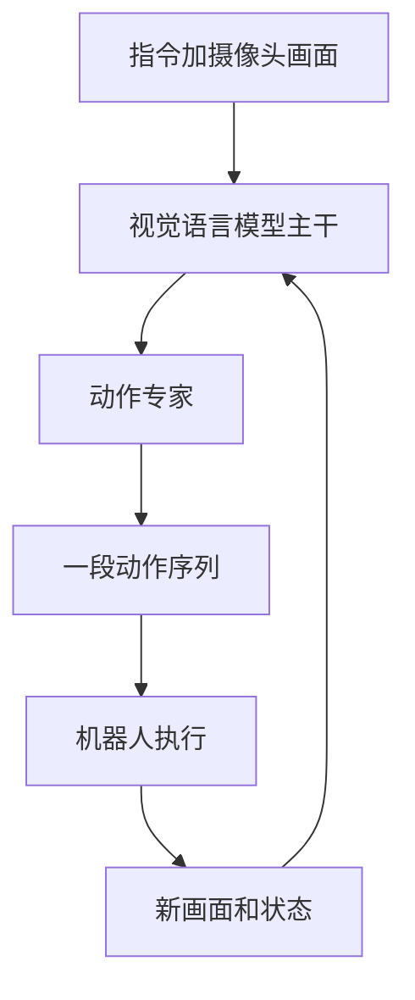

## Q
视觉-语言-动作模型（VLA，vision-language-action）怎样让机器人听懂"把衣服叠好"并动手？

## A
**VLA 在视觉语言模型上再接一个动作输出：输入摄像头画面、机器人当前状态和一句指令，输出一小段连续动作（关节角、夹爪），执行完再看一眼，循环往复。**

- **主干：** 一个预训练的视觉语言模型，懂图也懂字，所以能理解"叠好"这类语言。
- **动作：** 不是文字 token，而是连续数值：关节角度、夹爪开合，控制频率约每秒 50 次。
- **动作专家：** 一组专门的权重，用流匹配（和图像扩散同一类方法，从噪声逐步变成动作）一次输出一整段动作，而不是一个动作，动作更平滑，调用大模型的频率也更低。
- **数据：** 先用人遥控机器人的示范做监督训练，再加上机器人自己的尝试。

**新进展（2025 年 11 月）。** Physical Intelligence 发表 π*0.6，用 RECAP 方法让 VLA 从示范、自己的尝试和人的现场纠正中做强化学习；在家里叠衣服、装纸箱、用专业咖啡机做浓缩咖啡这几项上，难任务的吞吐量提高一倍以上，失败率约减半。

想一想：只用人的示范训练，机器人为什么会在真实环境里越做越错？
机器人一旦稍微偏离示范的轨迹，就进入示范里从没出现过的状态，错误一步步累积。自己的尝试和人的纠正恰好覆盖了这些偏离后的状态，这是强化学习补上的部分。

