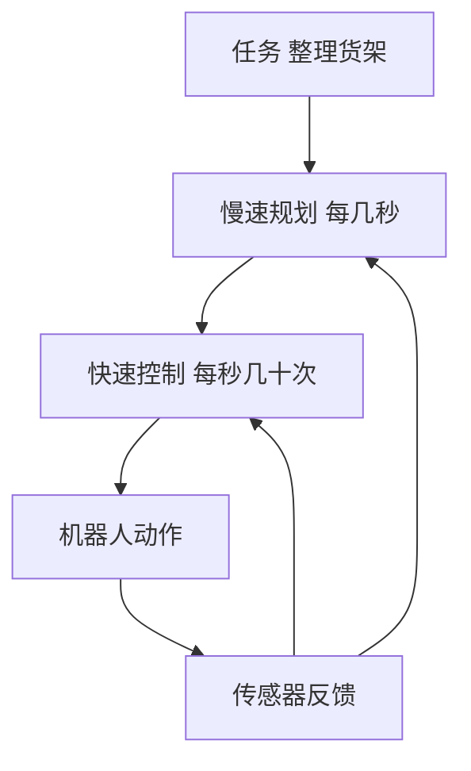

## Q
为什么机器人比聊天机器人进步慢得多？一个"单次成功率 95%"的拣货机器人能上线吗？

## A
**机器人缺大规模的动作数据，动作又不可撤销，还要实时控制，所以演示好看不等于能上线：每小时 600 次拣货，5% 失败就是每小时 30 次要人来救。**

- **数据：** 互联网上有海量文字，却几乎没有"动作"数据，只能靠人遥控机器人采集，又贵又慢。
- **不可撤销：** 文字写错可以重新生成，摔碎的杯子回不来。
- **实时：** 控制回路每秒几十次，大模型想一次要几秒，所以常分层：慢的规划器定目标，快的控制器管动作。
- **泛化：** 换一个厨房、换一种光线，成功率就掉。

**做法：** 先做窄而重复的任务，人在回路里兜底，并把人的纠正收回来当训练数据；上线指标不看单次成功率，看"每小时需要人介入几次"。成功率从 95% 提高到 99%，每小时要人救的次数从 30 次降到 6 次，只剩五分之一，所以商业价值取决于最后几个百分点。
