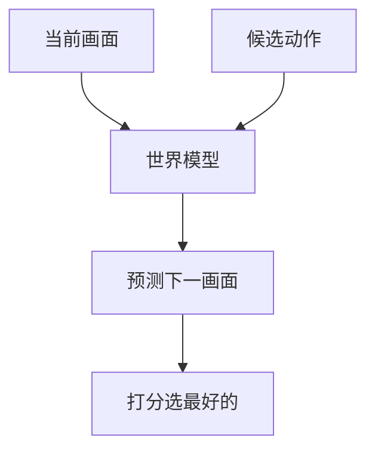

## Q
世界模型（world model）是什么？它和 VLA 有什么区别，拿来做什么？

## A
**世界模型预测"做了这个动作之后会看到什么"；VLA 回答"现在该做什么动作"。前者是环境的模拟器，后者是控制策略。**

| | VLA（策略） | 世界模型（模拟器） |
|---|---|---|
| 输入 | 画面、状态、指令 | 画面、状态、动作 |
| 输出 | 下一段动作 | 下一帧画面或它的抽象表示 |
| 用途 | 控制机器人 | 想象后果来规划、生成训练数据、评测策略 |

- **两种做法：** 一种生成像素，像视频扩散那样生成可交互的画面；另一种只预测抽象表示（JEPA 路线），不渲染每个像素，省算力。
- **连贯性是主要限制：** 规划要连续预测多步，时间一长场景里的物体会漂移，想象出来的后果就不可信。

**新进展（2026 年 3 月 – 10 月）。** 2026 年 3 月，LeCun 创立的 AMI Labs 宣布 10.3 亿美元种子轮，押注 JEPA 路线；10 月 27 日，DeepMind 预览 Genie 4，一个实时交互的世界模型，首次带原生音频，目前是研究预览。

想一想：为什么世界模型的连贯时间，直接决定它能规划多远？
规划要把动作一步步接在预测之后，每步预测都带误差，误差累积后画面偏离现实。连贯时间短，能可靠想象的步数就少，只够规划很短的动作，长任务仍要靠真实反馈。

