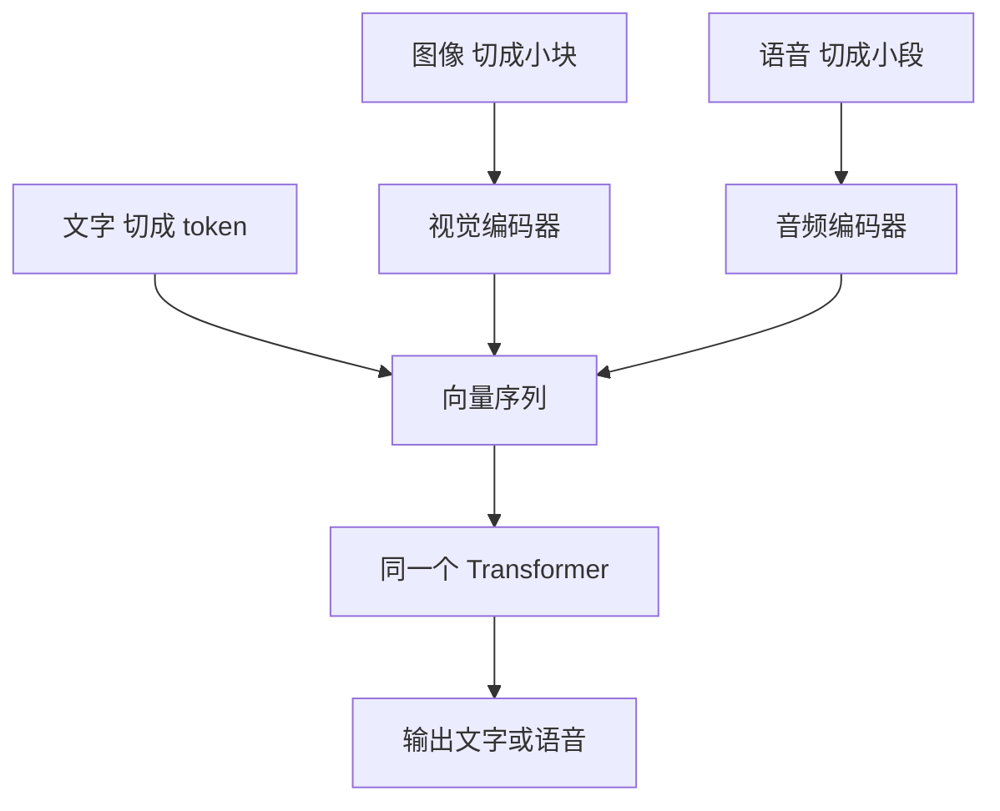

## Q
一张图片或一段语音，是怎么变成和文字一样、能交给同一个 Transformer 的输入的？

## A
**图像切成小方块、语音切成小段，各自由一个编码器变成和文字 token 同样宽度的向量，排进同一个序列，交给同一个 Transformer。**

- **图像的数字：** Claude 把图像切成 28×28 像素的小块，每块是一个视觉 token。1000×1000 的图是 ⌈1000÷28⌉ × ⌈1000÷28⌉ = 36 × 36 = 1,296 个 token。
- **语音：** 按很短的时间窗（几十毫秒量级）切成帧，编码成向量；视频就是一串抽样出来的图像帧。
- **为什么好：** 模型直接"看到"图里的文字、表格和版式，不是先用 OCR 变成文字再读，版面信息不丢。
- **输出：** 多数模型仍然只输出文字；原生语音模型也能直接输出音频 token。

**新进展（2026 年 5 月）。** OpenAI 发布 GPT-Realtime-2，一个原生的语音到语音模型：输入文字、音频、图像，直接输出文字和音频，取代"语音转文字、大模型、文字转语音"三段式。

想一想：三段式语音助手为什么听不出你的语气，也很难被打断？
第一段把语音转成文字时，语气、停顿、背景声都丢掉了；三段串行，延迟相加，说完整句才能开始处理。原生模型直接处理音频，保留这些信息，可以边听边答、被打断时立刻停。

