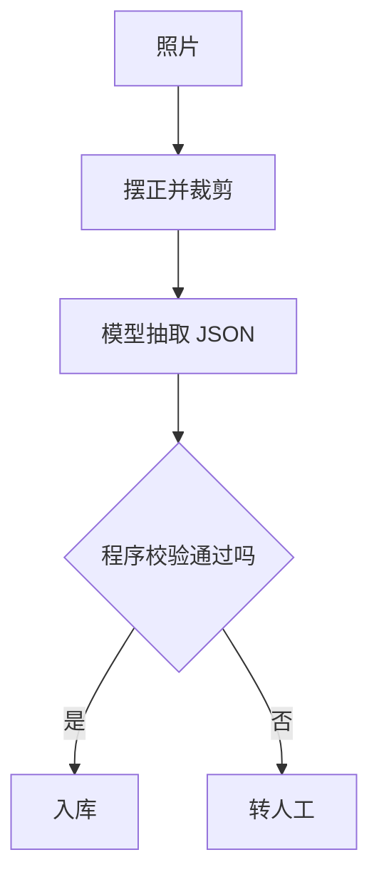

## Q
把发票照片交给多模态模型抽取合计金额，哪些地方会出错？怎么设计才可靠？

## A
**多模态模型看图是"近似读取"：小字、倾斜、密集表格会读错，数数和位置只是大致准确，所以数字要有程序校验，不能直接信。**

场景：抽取结果里有 3% 的发票，合计和明细之和对不上。

- **低质量图：** 模糊、旋转、小于 200 px 的图，模型可能编出内容。
- **数数不准：** 物体多而小时只能给近似个数。
- **坐标只是近似：** 让它框出某个区域，边框要核对。
- **不能做的事：** 判断一张图是不是 AI 生成的，或解读 CT、MRI 做诊断。

**设计要点：**
- 预处理：旋转摆正，把小字所在区域单独裁出放大。
- 要求模型读不清时填空并标记，不要猜。
- 校验：明细相加等于合计，日期格式合法，金额小数位合理。
- 校验失败或把握低，转人工。
- 校验的盲区：如果合计和明细被同一个原因读错，比如缩放过度让 8 和 3 全混了，相加仍然一致，只有人工抽查或更高分辨率重读才能发现。
