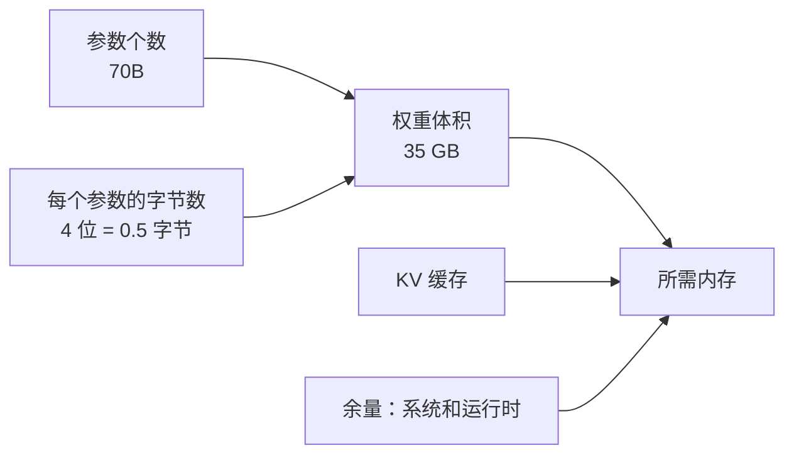

## Q
一台电脑能跑多大的开放权重模型？怎么用参数量估算内存，混合专家（MoE）模型又怎么算？

## A
**内存约等于参数个数乘每个参数的字节数，再加 KV 缓存和余量；量化把每个参数从 16 位压到 4 位，体积降到约四分之一。**

| 模型 | 16 位 | 8 位 | 4 位 |
|---|---|---|---|
| 7B | 14 GB | 7 GB | 3.5 GB |
| 70B | 140 GB | 70 GB | 35 GB |

- **要再留余量：** KV 缓存随上下文变长而增长，系统和运行时也占内存；4 位的 70B 权重 35 GB，机器要有明显更大的内存才宽裕。
- **混合专家：** 容量按总参数算，因为每个 token 可能走任何专家；速度按激活参数算，因为每个 token 只读被选中的专家。
- **例子：** gpt-oss-120b 是混合专家，OpenAI 称一张 80 GB 的卡装得下；gpt-oss-20b 约 16 GB 内存即可运行。
- **再降一档的代价：** 位数越低体积越小、质量损失越大，损失多少因模型和任务而异，要用自己的任务测。

**新进展（2025 年 8 月）。** OpenAI 发布 gpt-oss-120b 和 gpt-oss-20b，许可证为 Apache 2.0，混合专家层在训练后阶段就量化成 4 位格式（MXFP4）发布，这是 120B 能装进单卡的原因。

想一想：为什么直接以 4 位格式发布，比用户各自事后量化更可靠？
发布方在训练后阶段就用这种格式，可以在发布前测量质量损失并针对性修复；用户各自量化会得到不同软件、不同设置做出的不同版本，质量没有保证，出了问题也难复现。

