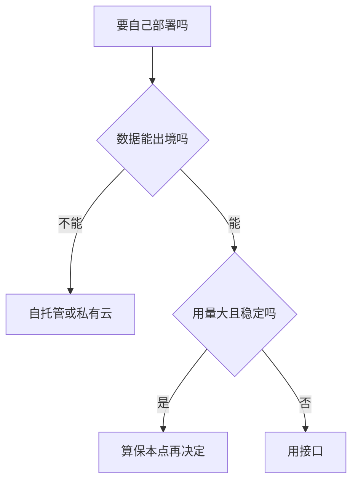

## Q
公司想用开放权重模型自己部署，替换按 token 付费的接口。什么时候划算，什么时候反而更贵？

## A
**自托管是固定成本，接口是按量付费：用量大而稳定、数据不能出境、需要深度定制时才划算；用量小或波动大时，闲置的 GPU 比接口账单更贵。**

**保本点 = 月固定成本 ÷ 接口单价。** 假设一台 8 卡服务器每月 1.5 万美元，接口混合价 2 美元每百万 token，保本点是每月 75 亿 token，约每天 2.5 亿。

**账上看不见的成本：**
- **利用率：** 夜里没人用也在付钱，保本点按满载算只是上限。
- **人：** 部署、监控、扩缩容、升级推理引擎要有人值班。
- **能力差距：** 开放模型通常比闭源旗舰低一档，更多重试和人工复核会吃掉省下的钱。
- **换代：** 新模型每几个月一批，每次换都要重新评测和适配。
- **供应链：** 下载权重要用 safetensors 格式（只存数字），旧的 pickle 格式在加载时可以执行夹带的代码。

**折中：** 先用托管的开放模型接口，保留迁移到自建的能力。例如实际每天只有 4,000 万 token，是保本点的 16%，自建每个 token 的成本约是接口的六倍多，应等用量逼近保本点，或合规要求自建时再迁移。
