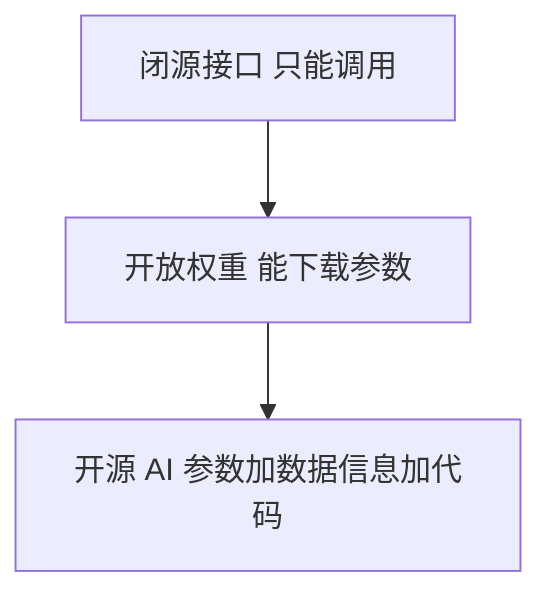

## Q
下载一个开放权重（open weights）模型，到底得到什么？它和"开源"、闭源接口有什么区别？

## A
**开放权重是把训练好的参数文件放出来，让你下载、自己运行和微调；通常不给训练数据和训练代码，所以不等于传统意义的开源。**



下载下来的是一个文件夹：

```text
model/
  model-00001.safetensors   参数
  config.json               层数、宽度等结构
  tokenizer.json            分词器
  LICENSE                   许可证
```

| | 闭源接口 | 开放权重 | 开源 AI（开源促进会 OSI 的定义） |
|---|---|---|---|
| 参数文件 | 看不到 | 能下载 | 能下载 |
| 训练数据和代码 | 无 | 通常无 | 要给足够细的信息 |
| 使用条件 | 服务条款 | 各家许可证不同 | 自由使用、修改、分享 |

- **本机运行：** `ollama run <模型名>` 会下载并启动，本机 11434 端口提供接口，应用像调云端接口一样调用它。
- **许可证要读：** DeepSeek 用 MIT，gpt-oss 用 Apache 2.0；Llama 的许可证限制用途，对月活超过 7 亿的公司另有条款，OSI 不认它是开源。

**新进展（2026 年 4 月）。** Meta 发布 Muse Spark，是它第一个不开放权重的前沿模型，接替了 Llama 路线。开放权重是各家的商业选择，不是前沿模型的默认。

<details class="pt"><summary>想一想：权重一旦公开就收不回，这对发布方的考虑意味着什么？</summary>发布方无法再控制谁在用、怎么用，也无法事后修补漏洞或撤回有风险的能力；对手还可以拿它做对比、蒸馏。所以越接近前沿，越要权衡是否放出，这是 Meta 转向闭源的一个现实背景。</details>
