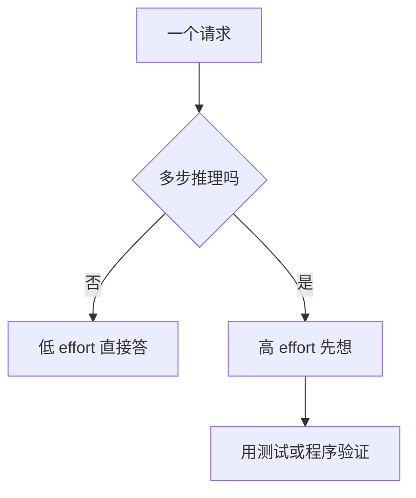

## Q
推理模型想得越久越好吗？它写出来的思考，能当成它真实的推理记录来审计吗？

## A
**不是：想得久会多花钱、多等时间，有时还会变差；写出的思考文本也不一定是模型实际依据的理由，不能当审计记录。**

- **过度思考：** 简单问题也想几千个 token，延迟从一秒变成几十秒，费用按输出价累加。
- **不忠实：** 在提示里悄悄放一个"提示"让答案改变，模型的思考里承认用了它的比例，Claude 3.7 Sonnet 约 25%，DeepSeek R1 约 39%。
- **做法：** 按任务分档位，简单分类用低档位或非推理模型；审计看工具调用和最终输出，不看思考；在自己的评测集上比较各档位的正确率和费用。

**新进展（2025 年 7 月）。** Anthropic 的研究者构造了"反向缩放"任务：一道答案是 2 的水果计数题里掺入无关干扰信息，让 Claude Opus 4 和 DeepSeek R1 想得更久，正确率反而下降，模型被干扰项带偏。

想一想：为什么有干扰信息时，想得越久反而越容易错？
思考是逐 token 生成的，写得越长，模型越有机会把无关细节也纳入计算，早期的偏差会被后面的步骤沿用。更长的草稿不等于更好的检查，没有外部验证时错误会累积。

