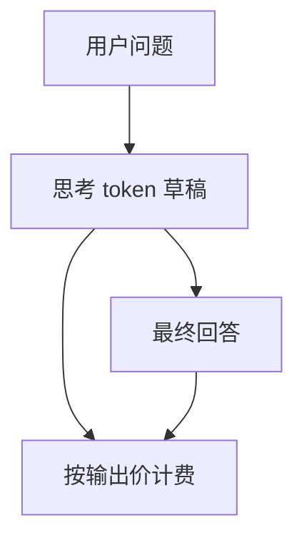

## Q
推理模型（reasoning model）和普通对话模型差在哪？"先想后答"具体是怎么发生的，要多花多少钱？

## A
**推理模型在回答之前先写一大段"思考 token"（给自己看的草稿），用更多推理时计算换更高的正确率；草稿也按输出 token 计费。**



```text
问：17 × 24 = ?
思考：17×24 = 17×20 + 17×4
     = 340 + 68 = 408，再验算 408÷24 = 17
答：408
```

- **为什么有效：** 模型生成每个 token 只做一次固定大小的计算；难题需要很多步，写出中间步骤就等于多算了几步，这就是"推理时算力"（test-time compute）。
- **怎么学会：** 用强化学习（RL）训练，奖励只看最终答案对不对，模型发现写步骤、自我检查能得更多分。
- **账怎么算：** 按 Claude Opus 5.5 的输出价每百万 token 20 美元，8,000 个思考 token 约 0.16 美元；同一问题直接回答 200 token 约 0.004 美元，贵 40 倍。
- **适合：** 数学、代码、多步规划。**不适合：** 查一个事实、改写一句话。
