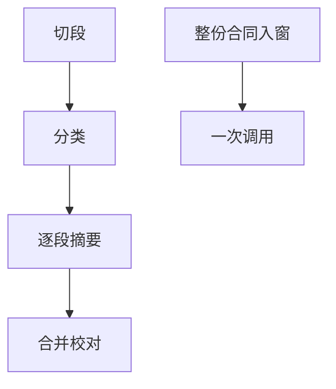

## Q
"苦涩的教训"（bitter lesson）是什么？一个做产品的工程师应该从中学到什么？

## A
**Sutton 在 2019 年总结：七十年里，利用算力的通用方法（搜索和学习）最终总是胜过人类手工注入的领域知识；对工程师来说，别在会被下一代模型吃掉的地方堆脚手架。**

例子：国际象棋靠大规模搜索胜过手写棋理，语音和视觉里手工特征输给了深度学习。

场景：2024 年团队给合同摘要做了五段流水线和一堆提示模板，维护很重；新模型一次读完整份合同，摘要更好、更快。

| 容易被吃掉 | 不容易被吃掉 |
|---|---|
| 手工切分、提示技巧、手调思考预算 | 私有数据的检索和权限 |
| 对旧模型弱点的绕路 | 评测集和验收标准 |
| 自写的多步编排 | 不可逆操作前的人工确认 |

- **反面：** 规模不是免费的，受限于高质量数据、电力和费用；效率研究（混合专家、注意力改进）本身也要靠算力才能验证。
- **做法：** 脚手架写得薄、可删；每次换新模型，先试"去掉脚手架"的版本。

**新进展（2026 年 2 月 – 11 月）。** Anthropic 的接口把手设的思考预算换成"模型自己决定想多深"，4.7 及之后的模型直接拒绝 `budget_tokens`。这是又一个手工旋钮被模型本身吃掉的例子。

想一想：你们产品里哪一类东西最不可能被下一代模型吃掉？
模型再强也不知道你们的私有数据和权限规则，也不能替人对不可逆操作负责。评测集和验收标准定义了什么叫做对，只能由使用者来定。这几类都值得投入。

