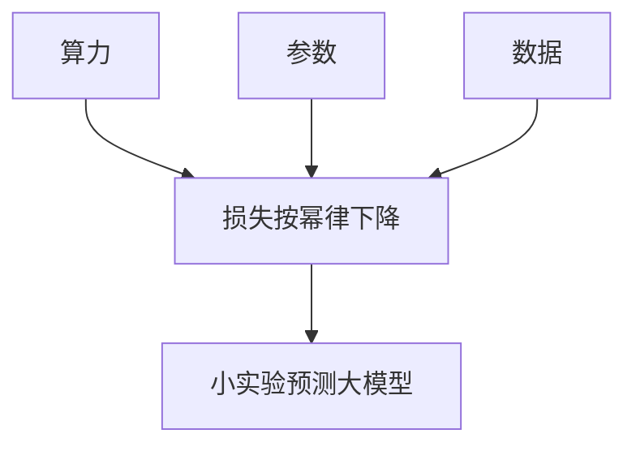

## Q
规模定律（scaling laws）说了什么？为什么实验室敢花几十亿美元去训练一个还没出生的模型？

## A
**模型的损失随算力、数据、参数增加而平滑下降，而且能预测：先用小规模实验拟合曲线，就能估计大模型会有多好。**

- **形式：** 损失随规模按幂律下降，在双对数图上是一条直线；每把算力乘 10，损失按固定比例降低。
- **Chinchilla 配比（2022）：** 算力固定时，参数和数据要一起增长，约每个参数配 20 个训练 token。70B 的模型对应 1.4 万亿 token。
- **实际上都"过量训练"：** 训练只花一次，推理每个 token 都要花钱。同样的质量，更小的模型训练更久，上线后每次调用更便宜。

| 模型 | 训练 token | 每参数 token |
|---|---|---|
| Chinchilla 配比的 70B | 1.4 万亿 | 20 |
| Llama 3 的 8B | 超过 15 万亿 | 约 1,875，是配比的约 94 倍 |

**新进展（2026 年 4 月）。** 一篇预印本把推理时的多次采样也算进总预算，联合优化模型大小和训练 token，结论是应该用更小、训练更久的模型。它只在 8 个任务上测过，尚未经过评审。

想一想：为什么模型上线后要多采样几次，反而会让"小而久训"更划算？
每次调用的推理成本正比于模型大小乘采样次数；模型越小，同样预算下就能多采样、多验证。训练一次的额外成本被摊到所有调用上，调用越多越划算。

