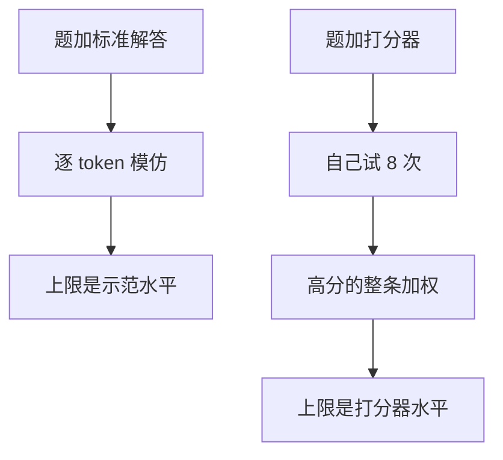

## Q
监督微调（SFT，supervised fine-tuning）和强化学习（RL，reinforcement learning）都是预训练之后继续训练模型，区别在哪？用一道题说明。

## A
**SFT 把标准答案给模型看，让它逐字模仿，上限是示范本身；RL 只给目标和打分器，让模型自己试，上限是打分器能分辨的水平。** 记忆钩子：月之暗面（Moonshot，做 Kimi 的公司）创始人杨植麟拿它比喻管理，手把手教每一步，还是只给目标和奖励。

题目：「一件活 3 人做 4 天，6 人做要几天？」

| | SFT | RL |
|---|---|---|
| 训练数据 | 题加人写的解答 | 题加一个判对错的程序 |
| 一次训练 | 每个位置预测示范里的下一个 token | 模型写 8 个解答，答案是 2 得 1 分，否则 0 分 |
| 学到什么 | 示范里出现过的写法 | 哪类整体做法更容易得分 |
| 成本 | 人写示范贵 | 要大量采样和算力，打分器要可靠 |

- **典型分工：** 先用少量 SFT 教格式和对话，再用 RL 在能自动判对错的任务（数学、代码）上继续提高。
- **RL 的前提：** 必须有便宜又可靠的打分器；写作风格这类没有标准答案的任务，打分仍要靠人的偏好。
