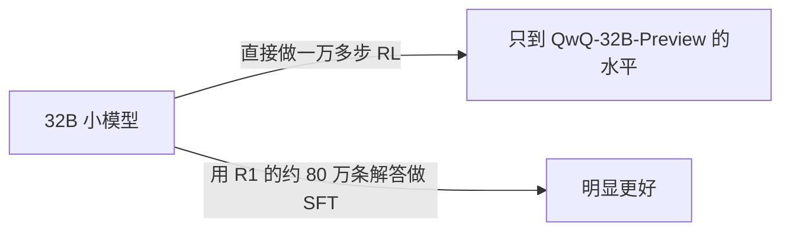

## Q
推理模型为什么要靠强化学习训练？RL 的上限真的比 SFT 高吗，和"拿大模型的解答做 SFT"比呢？

## A
**RL 能让模型发现示范里没人写过的做法（很长的推理、回头检查），所以在能自动判对错的任务上上限更高；但把大模型的解答拿来做 SFT，是把能力传给小模型更便宜的办法。**

- **R1-Zero 的实验：** DeepSeek 只用"最终答案对不对"作奖励，从基座模型直接做 RL，美国数学竞赛题 AIME 2024 的正确率从约 16% 升到 70% 以上；模型自己学会了写长推理、算错了回头重来。
- **对比：** 在 32B 的小模型上直接做一万多步 RL，只到 QwQ-32B-Preview 的水平；用 R1 的约 80 万条解答做 SFT，同样的 32B 明显更好。

- **读法：** 小模型自己很难摸索出好策略，从强模型的示范里学更快；但示范学到的天花板是那个强模型，往上推要靠 RL。

| | SFT（含蒸馏） | RL |
|---|---|---|
| 擅长 | 传递已有能力、格式、风格 | 开拓：在可验证任务上超出示范 |
| 瓶颈 | 示范的质量和数量 | 打分器的漏洞和采样成本 |

**新进展（2026 年 4 月）。** 学界仍在争论可验证奖励的强化学习（RLVR）到底有没有教出新能力：一些论文说它扩展了推理边界，另一些发现多数提升来自"更稳地走通基座本来偶尔能走通的路"。检验办法之一是比较 pass@1 和 pass@256（采样 256 次至少对一次）。

想一想：如果 RL 只是让模型更稳地走通基座本来偶尔能走通的路，pass@1 和 pass@256 各会怎样变？
pass@1 会大幅上升，因为模型把原本偶尔的成功变成了常态；pass@256 的差距会缩小甚至持平，因为基座采样很多次本来就能碰到这些路。若 pass@256 也明显上升，才说明学到了基座走不到的新做法。

