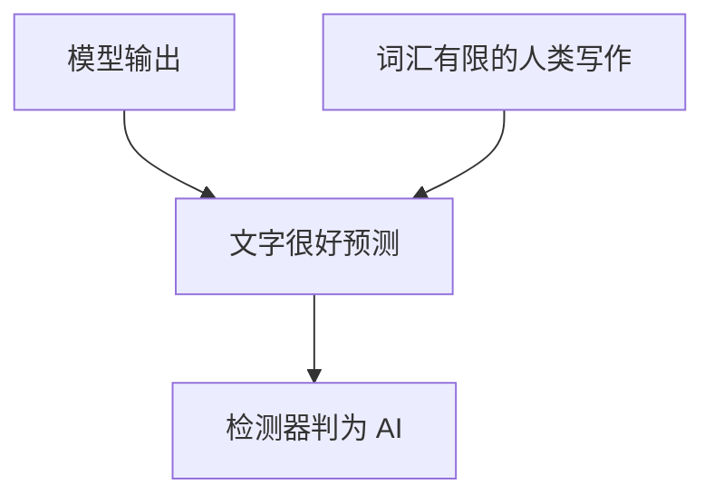

## Q
老师用 AI 检测器，或者凭"AI 味"来判断一篇作文是不是 AI 写的，靠得住吗？

## A
**靠不住：检测器和"AI 味"都只是统计倾向，误判偏偏落在写得规整、词汇有限的人身上。**

**两个数字：**
- OpenAI 自己做的检测器（2023 年 1 月上线）只认出 26% 的 AI 文字，还把 9% 的人写文字误判为 AI，2023 年 7 月下线，理由是准确率低。
- 斯坦福的一项研究（Liang 等）用 7 个检测器测 91 篇非英语母语者写的托福作文，平均约 61% 被判为 AI。检测厂商 Turnitin 对此有异议，所以这个比例仍有争议。

**为什么：** 多数检测器看困惑度（perplexity，下一个词有多好猜）。模型的输出好猜；词汇有限、句式规整的人写的文字也好猜。

**怎么办：**
- 把检测分数当线索，不当证据。
- 看写作过程：草稿、修订历史、当面问几个细节。
- 别凭"有没有破折号"下结论。
