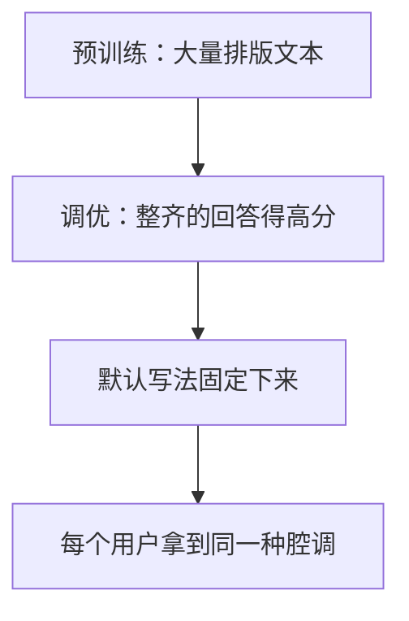

## Q
为什么不同的人用 AI 写出来的文字读起来都像同一个人？破折号、"值得注意的是"、"不是……而是……"这些"AI 味"从哪来？

## A
**模型把训练和调优中被奖励的写法学成了默认值，所以所有人拿到的文字都带着同一套习惯。**

**常见特征：** 破折号（em dash，——）、"值得注意的是""总的来说"、"不是 A，而是 B"的对比句、三项并列、结尾一句总结升华。

**已知的成因：**
- 预训练读过大量排版整齐的文本（标题、列表、加粗），结构化的写法成了本能。
- 调优阶段（SFT 和人类反馈强化学习 RLHF）里，人倾向给面面俱到、结构整齐的回答打高分，模型被推向这种写法。
- 同一个模型服务几百万人，于是几百万人带着同一个"口音"。

**「推测」：** 英文里 "delve" 这类词偏多，有人猜是标注员的英语用词习惯被放大了；没有定论。

**新进展（2025 年 11 月）。** Sam Altman 在 X 上说，在 ChatGPT 的自定义指令里写"别用破折号"，它现在终于照做了，称这是"小而开心的胜利"。此前用户无论怎么要求都改不掉，说明这个习惯压得很深。

想一想：为什么在这之前，提示里写"不要用破折号"也压不住它？
习惯写在训练出来的概率分布里，是几乎每个位置都在起作用的倾向；提示只是上下文里的一句话，要靠再训练才能让它真正听话。

