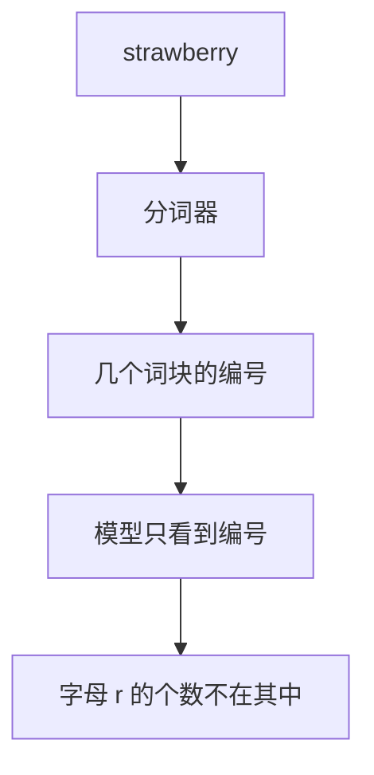

## Q
问模型"strawberry 里有几个 r"，或"9.11 和 9.9 哪个大"，它为什么会答错？

## A
**模型读到的是 token（词块）的编号，不是一个个字母和数位；"有几个 r"在输入里没有直接写出来，只能靠训练时背下的拼写，或者自己一步步拆开写。**

- **字母：** 分词器把 strawberry 切成几个词块（切法因分词器而异），每块是一个整体。一项研究发现，模型认得出字母，但数不对；单词越长、同一个字母出现超过两次，错得越多。
- **小数：** 9.11 常被切成"9""."和"11"。一种常见说法是模型拿 11 去比 9；另一种是训练数据里版本号太多（9.11 版晚于 9.9 版）。这两种说法目前只有零散的实验，属「推测」。
- **不是全盲：** 模型从训练里学到很多词的拼写，常见词常常答对，所以错得看起来像随机。

**新进展（2026 年 1 月）。** 一个专测字符级操作的基准（SubTokenTest）用线性探针读 Qwen2.5-7B 的内部状态，发现"这个词里每个字母各出现几次"的信息在前两三层就能读出，普通词比错拼词或随机字母更清楚。这说明模型是在间接地"记住拼写"，而不是真的看见字母。

想一想：既然拼写是记住的，为什么对一串随机字母数数，模型会比对 strawberry 这样的常见词错得更多？
常见词的拼写在训练里出现过很多次，能被记住；随机字母没见过，没有可背的东西，只剩把词块拆开再数这条路，而它没有直接拆字母的输入。

