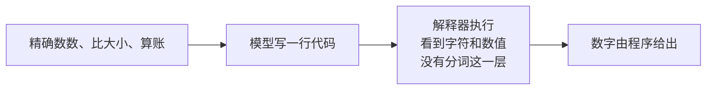

## Q
要让模型统计一份日志里某个词出现了几次，或者比较两个小数的大小，怎样做才靠谱？

## A
**凡是要精确数数、比大小、算账的，让模型写代码或调用工具去算，不要让它心算；模型只负责写对那一行。**

```python
"strawberry".count("r")          # 3
float("9.11") < float("9.9")     # True
sum(1 for _ in open("app.log") if "ERROR" in _)
```



- **为什么靠谱：** 解释器看到的是字符和数值，没有分词这一层；错误从"数不准"变成"代码写错"，后者能测试、能复查。
- **大文本别口算：** 把几万行塞进窗口再问"有几处"，模型只会估个大概；让它写 `grep -c` 或脚本，数字由程序给出。
- **不能用工具时：** 要求模型先把词用空格拆成单个字母再数，或把小数补齐位数（9.90 对 9.11）；能降低错误，不能保证。
- **同一个原因：** 字数限制、押韵、音节数都是字符级任务，模型一样做不准，产品里要有程序校验。
