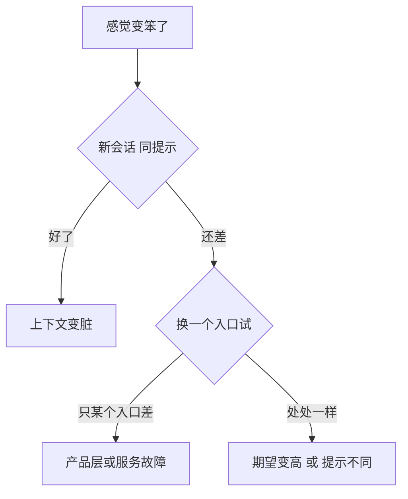

## Q
"这个模型最近变笨了"，可能是哪几种情况？怎么先分辨？

## A
**同一个版本号的模型自己不会变；"变笨"通常来自四处之一：你的期望变高了、上下文变长变脏了、模型外面那层产品（系统提示、默认推理强度）改了、推理服务出了故障。**

| 原因 | 典型症状 | 怎么确认 |
|---|---|---|
| 期望变高 | 同样的答案现在觉得平庸 | 拿旧对话的原提示重跑 |
| 上下文变脏 | 越聊越糊涂，忘了约束 | 同一提示开新会话 |
| 产品层改动 | 只在某个应用里变差 | 用 API 直调对比 |
| 服务故障 | 时好时坏，只影响部分请求 | 换入口、重试、看别人是否也遇到 |

**新进展（2026 年 3 月 – 4 月）。** Anthropic 复盘了 Claude Code 的质量下降：3 月 4 日默认推理强度从 high 改成 medium；3 月 26 日一个本应只清理空闲会话旧思考的改动，因 bug 每一轮都清，Claude 显得健忘重复；4 月 16 日一条限制啰嗦的系统提示拖低了编码质量。三项在 4 月 7 日到 20 日之间陆续还原或修复，API 不受影响。

想一想：这三个互相独立的改动，为什么在用户看来像"模型整体变笨了"？
三个改动影响不同的流量切片，生效时间也不同，叠加起来就是持续、忽好忽坏的变差，用户看不到背后是哪一项，只能感到整体不对。

