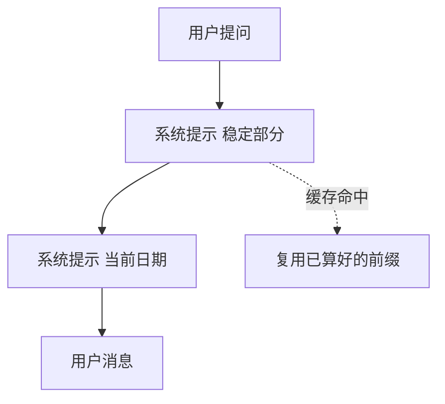

## Q
你的产品接了模型 API，用户问"现在几号""你是哪个模型""最新的 iPhone 是哪款"，它都答错了。怎么办？

## A
**API 不会替你注入日期和身份：把当前日期、产品名和边界写进你自己的系统提示，并给它搜索工具回答最新的事。**

```
你是「小禾」，X 公司的客服助手。
当前日期：2026-11-15，星期日，北京时间。
你的知识有截止日期；比它新的事先搜索，
搜不到就说不确定。
不要说自己是某个具体的底层模型。
```

- **写星期和时区：** "下周三""明天"这类相对日期，模型靠自己算很容易错一天；给出日期、星期和时区，错误少得多。
- **身份：** 用户问"你是不是 GPT"，让它回答"我是小禾，底层模型由我们选定"，比让它乱猜好；这也避免它说出别家的名字。
- **最新的事交给搜索：** 模型的知识有截止，回答最新机型、价格、人事时，先搜索再答。
- **别把时间戳放在提示开头：** 提示缓存要求前缀逐字相同，开头放一个精确到秒的时间，每次请求都变，缓存永远命中不了。日期放在提示末尾或用户消息里，或者只写到天。



稳定的内容放前面，会变的放后面，前缀才能一直命中。
