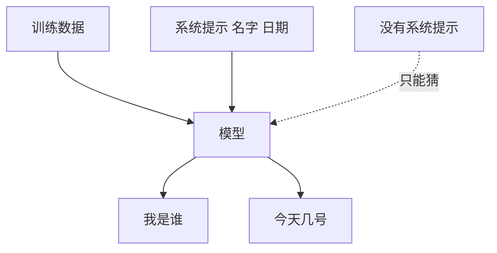

## Q
问模型"你是哪家的模型？今天几号？"，它有时答错，甚至自称别家的模型。为什么？

## A
**模型对自己和对"今天"的了解只来自两处：训练数据和系统提示；没人告诉它，它就按训练数据里最常见的样子猜。**

- **身份：** 训练文本里"我是 ChatGPT"这类自我介绍特别多，通过 API 调用、没有系统提示的模型，可能照着说出别家的名字。
- **日期：** 模型没有时钟。训练结束之后的时间对它不存在，没人告诉它的话，它会默认"现在"离训练截止时间不远。
- **截止时间也靠告知：** 模型自报的"知识截止日期"不可靠：有测量发现多数前沿模型的自报偏早，也有研究发现在某些主题上模型的有效截止比宣称的更早。所以厂商把"可靠截止"写进系统提示。
- **所以产品要补：** claude.ai 的系统提示在每次对话开头注入当前日期；调用 API 时没有这段，要自己写。

**新进展（2026 年 10 月）。** claude.ai 里 Opus 5.5 的系统提示写明了模型名，并把"可靠知识截止"定为 2026 年 6 月底，要求它像当时一位消息灵通的人那样回答，对更新的事说明可能过时并建议搜索。

想一想：系统提示为什么既要给"当前日期"，又要给"可靠知识截止"？
模型自己既不知道今天是哪天，也不准确知道自己知道到哪天；两个都告诉它，它才能算出中间有多长的空白期，知道这段时间的事自己并不知道，该去搜索。

