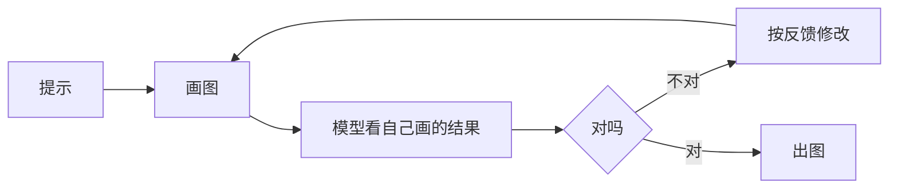

## Q
现在的图像模型还会犯这两个错吗？通过了这两个测试，是不是就说明偏差解决了？

## A
**截至 2026 年 11 月：老一代模型仍会犯；会检查自己输出的新模型，在不少评测者的单次测试里能过，但还没有系统性的测量。**

| 时间 | 模型 | 测试结果 |
|---|---|---|
| 2025 年 3 月 | Gemini 2.0 Flash（实验版） | 钟表第一次就对（但指定具体时间仍然难）；满杯酒迭代了 5 次才满 |
| 2025 年 12 月的复测 | DALL·E 3、FLUX.1 | 要 6:30 的钟，两张都是 10:10 |

能改善的关键，是模型能看自己画的结果，再按反馈修改，而不是一次画成。

**通过测试不等于解决了偏差：**
- 这两个测试已经很有名，厂商可能针对性地修补，属于「推测」；通过它们不说明同类的偏差都没了。
- 要换新的组合来验证：倒满的啤酒、指着 7:23 的手表、"没有大象的房间"、左撇子握笔。
- 单次通过也可能是运气，要多生成几张看通过率。

**新进展（2025 年 11 月）。** Google 的 Nano Banana Pro（Gemini 3 Pro Image）发布后，多位评测者报告它在一次测试里同时画对了指定时间的钟和满杯酒，而上一代 Nano Banana 通不过。这些都是单次、非系统的测试，另有评测者说它在具体时间上仍要反复试。

想一想：某个模型通过了"满杯酒"测试，你还要再测什么，才能说它克服了这类偏差？
换一批没有出名的"罕见组合"再测，比如倒满的啤酒或指着 7:23 的表，并多生成几张看通过率。只通过出名的测试，可能只是被针对性修补过。

