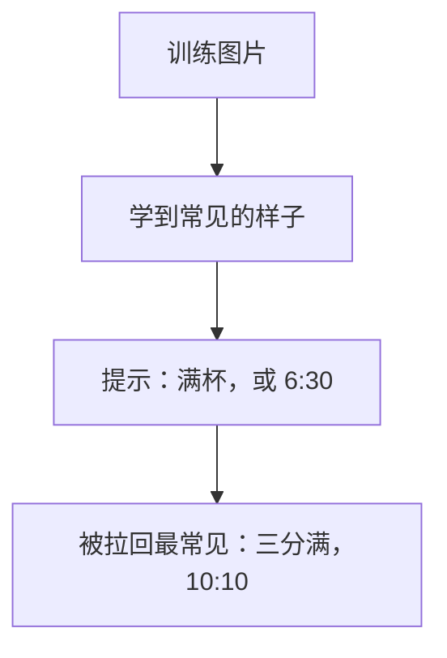

## Q
为什么图像模型画不出倒满的红酒杯，画的钟表又总是指向 10:10？

## A
**生成模型学的是训练图片里"最常见的样子"，不是物理和规则；数据里几乎没有的组合（满到杯口的酒、指着 6:30 的钟），它就被拉回最常见的样子。**

这类模型多是扩散模型（diffusion model，从一团噪声一步步去噪画出图）。它不是先算"满杯该是什么样"再画，而是一步步把图拉向它见过的图。

- **酒杯：** 照片里的"一杯酒"几乎都倒到杯子的三分之一到一半，"满到杯口"在数据里很少见。
- **钟表：** 商品图和广告里的指针几乎都摆在 10:10，常见的说法是这样指针不遮住品牌标志，还像个笑脸。这个解释流传很广，但没有公开的统计证实训练集里的比例，属于「推测」。
- **例子：** 一次测试让 DALL·E 3 画指向 6:30 的钟，两张图都是 10:10。

**新进展（2026 年 4 月）。** OpenAI 发布 ChatGPT Images 2.0（接口名 gpt-image-2），宣称画图前会先推理。这直接对着这张卡的症结：模型不再只靠"最常见的样子"一步画成。

想一想：为什么"先推理再画"有可能帮助画对指定时间的钟？
推理可以先算出指针该在的角度，画完再检查，让结果由规则决定，而不只是由训练图里最常见的样子决定。具体成功率要看实测。

